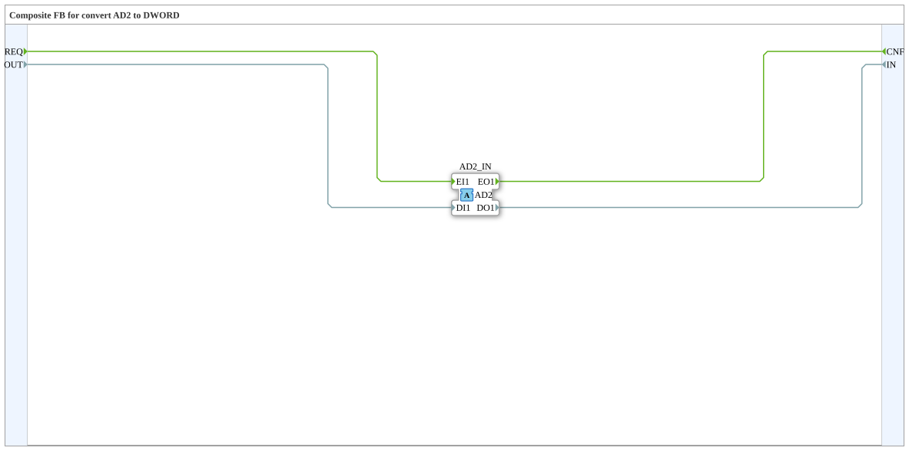

# AD2_D_TO_DWORD

* * * * * * * * * *

!!! warning "Not released yet"
    The block is defined as a type in the library (as of 2026-11-13). The matching firmware side (C++ and ELF libraries) has not been released yet. Do not assume it is runnable yet.

## Introduction

`AD2_D_TO_DWORD` is a composite block: Composite FB for convert AD2 to DWORD.

## Interface structure

### **Event inputs**

| Event | Type | With | Description |
| --- | --- | --- | --- |
| REQ | Event | OUT | Request to Adapter |

### **Event outputs**

| Event | Type | With | Description |
| --- | --- | --- | --- |
| CNF | Event | IN | Confirmation from Adapter |

### **Data inputs**

| Name | Type | Description |
| --- | --- | --- |
| OUT | DWORD | Output data to Adapter |

### **Data outputs**

| Name | Type | Description |
| --- | --- | --- |
| IN | DWORD | Input data from Adapter |

### **Adapters**

| Role | Name | Type | Description |
| --- | --- | --- | --- |
| Socket | AD2_IN | adapter::types::bidirectional::AD2 | Adapter Input |

## How it works

The connections are listed in the section “Connections inside the block”. There are no internal function blocks, the block only wires adapters and inputs/outputs.

## Connections inside the block

**Event connections:**

- `AD2_IN.EO1` → `CNF`
- `REQ` → `AD2_IN.EI1`

**Data connections:**

- `AD2_IN.DO1` → `IN`
- `OUT` → `AD2_IN.DI1`

## Technical notes

- Initial Version - Luecke geschlossen (analog zu AB2_B_TO_BYTE)

## ⚖️ Comparison with similar blocks

Blocks of the same family are in the same folder or in the neighbouring folders of `conversion`.
