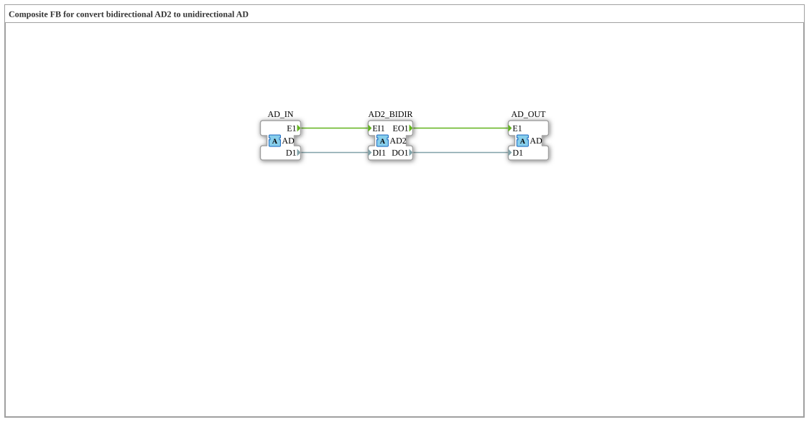

# AD2_TO_AD

* * * * * * * * * *

!!! warning "Not released yet"
    The block is defined as a type in the library (as of 2026-11-13). The matching firmware side (C++ and ELF libraries) has not been released yet. Do not assume it is runnable yet.

## Introduction

`AD2_TO_AD` is a composite block: Composite FB for convert bidirectional AD2 to unidirectional AD.

## Interface structure

### **Event inputs**

No direct events.

### **Event outputs**

No direct events.

### **Data inputs**

No direct data.

### **Data outputs**

No direct data.

### **Adapters**

| Role | Name | Type | Description |
| --- | --- | --- | --- |
| Socket | AD2_BIDIR | adapter::types::bidirectional::AD2 | Adapter Input: bidirectional tap, incoming side forwarded to AD_OUT, outgoing side driven by AD_IN |
| Socket | AD_IN | adapter::types::unidirectional::AD | Adapter Input: unidirectional source |
| Plug | AD_OUT | adapter::types::unidirectional::AD | Adapter Output: mirrors AD2_BIDIR's incoming (indication) side |

## How it works

The connections are listed in the section “Connections inside the block”. There are no internal function blocks, the block only wires adapters and inputs/outputs.

## Connections inside the block

**Event connections:**

- `AD2_BIDIR.EO1` → `AD_OUT.E1`
- `AD_IN.E1` → `AD2_BIDIR.EI1`

**Data connections:**

- `AD2_BIDIR.DO1` → `AD_OUT.D1`
- `AD_IN.D1` → `AD2_BIDIR.DI1`

## Technical notes

- Initial Version - Luecke geschlossen (analog zu AB2_TO_AB)

## ⚖️ Comparison with similar blocks

Blocks of the same family are in the same folder or in the neighbouring folders of `conversion`.
