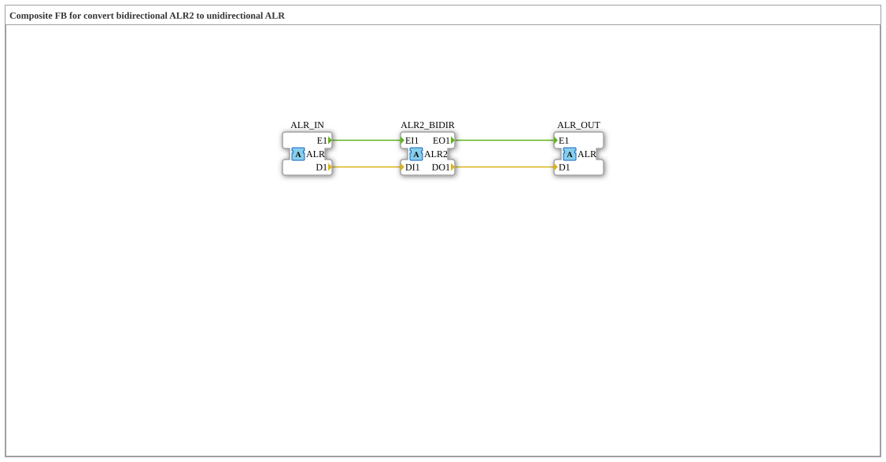

# ALR2_TO_ALR

* * * * * * * * * *

## Introduction

`ALR2_TO_ALR` is a composite function block that connects a bidirectional [ALR2](../../../types/bidirectional/REAL/ALR2.md) tap with unidirectional [ALR](../../../types/unidirectional/LREAL/ALR.md) adapters (LREAL): the incoming side of `ALR2_BIDIR` is output as a plain unidirectional signal via `ALR_OUT`, and `ALR_IN` is published onto the outgoing side of `ALR2_BIDIR`.

## Interface Structure

### **Event Inputs**

The function block has no direct event inputs — communication happens exclusively through the adapters.

### **Event Outputs**

The function block has no direct event outputs.

### **Data Inputs**

The function block has no direct data inputs.

### **Data Outputs**

The function block has no direct data outputs.

### **Adapters**

- **ALR2_BIDIR** (Socket): bidirectional tap whose incoming side is forwarded to `ALR_OUT` and whose outgoing side is fed by `ALR_IN`, of type `adapter::types::bidirectional::ALR2`
- **ALR_IN** (Socket): unidirectional source, of type `adapter::types::unidirectional::ALR`
- **ALR_OUT** (Plug): mirrors the incoming (indication) side of `ALR2_BIDIR`, of type `adapter::types::unidirectional::ALR`

## Functionality

The block consists of just four connections:

- Event: `ALR2_BIDIR.EO1` → `ALR_OUT.E1`; data: `ALR2_BIDIR.DO1` → `ALR_OUT.D1`
- Event: `ALR_IN.E1` → `ALR2_BIDIR.EI1`; data: `ALR_IN.D1` → `ALR2_BIDIR.DI1`

Whatever a bidirectional peer attached to `ALR2_BIDIR` reports therefore appears unchanged at `ALR_OUT`; whatever arrives at `ALR_IN` is passed on to the bidirectional peer.

## Technical Details

- Pure wiring, no logic or state
- Every destination variable has exactly one writer
- Without an attached bidirectional peer, `ALR_OUT` stays idle

## Application Scenarios

- Reading a bidirectional ALR2 peer as a plain unidirectional ALR signal while injecting a separate unidirectional signal
- Bridging a bidirectional ALR2 zone and a unidirectional ALR zone

## Conclusion

`ALR2_TO_ALR` is a tap point without logic: it makes the incoming side of a bidirectional ALR2 peer visible as a unidirectional ALR signal and simultaneously feeds a unidirectional signal into the outgoing side.
