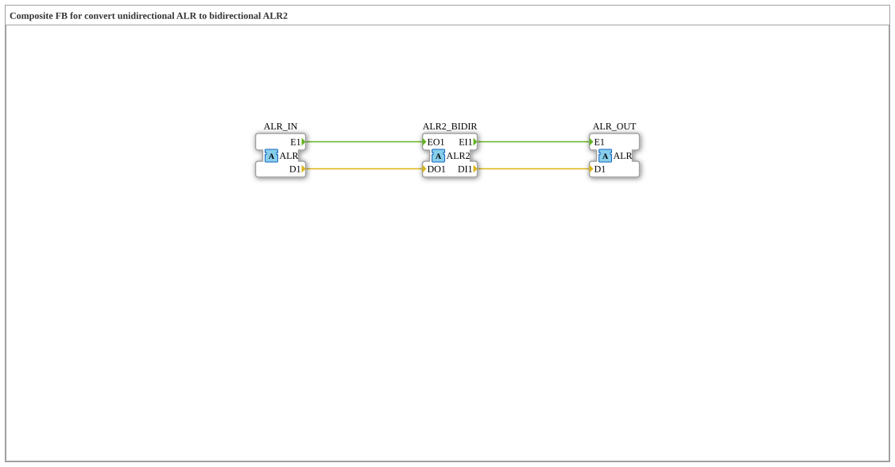

# ALR_TO_ALR2

* * * * * * * * * *

## Introduction

`ALR_TO_ALR2` is a composite function block that converts a **unidirectional** `ALR` adapter into a **bidirectional** `ALR2` adapter. `ALR_IN` is written onto the outgoing side (`EO1`/`DO1`) of `ALR2_BIDIR`; whatever `ALR2_BIDIR` receives on its incoming side (`EI1`/`DI1`) is output again as a plain unidirectional signal via `ALR_OUT`.

## Interface Structure

### **Event Inputs**

*No direct event inputs - events arrive via the adapter sockets/plugs*

### **Event Outputs**

*No direct event outputs*

### **Data Inputs**

*No data inputs*

### **Data Outputs**

*No data outputs*

### **Adapters**

- **ALR_IN** (socket): Unidirectional adapter of type `adapter::types::unidirectional::ALR` - unidirectional source
- **ALR2_BIDIR** (plug): Bidirectional adapter of type `adapter::types::bidirectional::ALR2` - outgoing side driven by `ALR_IN`, incoming side forwarded to `ALR_OUT`
- **ALR_OUT** (plug): Unidirectional adapter of type `adapter::types::unidirectional::ALR` - mirrors the incoming (request) side of `ALR2_BIDIR`

## How it works

1. `ALR_IN.E1` is forwarded to `ALR2_BIDIR.EO1` and `ALR_IN.D1` to `ALR2_BIDIR.DO1`.
2. `ALR2_BIDIR.EI1` is forwarded to `ALR_OUT.E1` and `ALR2_BIDIR.DI1` to `ALR_OUT.D1`.

## Technical Details

- Pure event/data connections (`FBNetwork`), no logic of its own and no internal state
- Part of the conversion family (analogous to `AR2`/`AB2`/`AE2`); the data type is `LREAL`

## Application Scenarios

- Connecting unidirectional `ALR` sources and sinks to a bidirectional `ALR2` adapter

## Summary

`ALR_TO_ALR2` combines a unidirectional `ALR` input and output into a bidirectional `ALR2` adapter.
