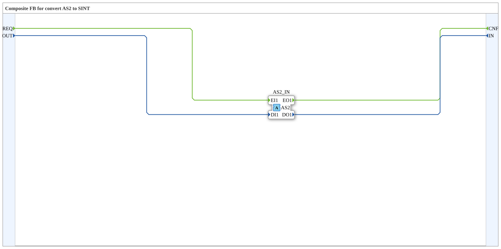

# AS2_S_TO_SINT

* * * * * * * * * *

## Introduction

`AS2_S_TO_SINT` is a composite FB that mediates between a `SINT` data pair (`OUT`/`IN`) and the bidirectional adapter `AS2`. In contrast to the plug variant `AS2_SINT_TO_R` it has an adapter **socket** (input). It completes the conversion family analogously to `AR2`/`AB2`/`AE2`.

## Interface Structure

### **Event Inputs**

- `REQ`: Request to the adapter. Associated data: `OUT`.

### **Event Outputs**

- `CNF`: Confirmation from the adapter. Associated data: `IN`.

### **Data Inputs**

- `OUT` (`SINT`): Value sent to the adapter.

### **Data Outputs**

- `IN` (`SINT`): Value received from the adapter.

### **Adapters**

| Direction | Name | Adapter type | Comment |
| :--- | :--- | :--- | :--- |
| **Socket** (input) | `AS2_IN` | `adapter::types::bidirectional::AS2` | Adapter input. |

## Functionality

The block contains no internal FBs, only connections:

- `REQ` → `AS2_IN.EI1` and `OUT` → `AS2_IN.DI1`: a `REQ` event sends the value `OUT` through the adapter.
- `AS2_IN.EO1` → `CNF` and `AS2_IN.DO1` → `IN`: an event coming from the adapter is output as `CNF`, and the received value appears at `IN`.

## Technical Details

- Pure pass-through without logic and without internal state.
- The data type is `SINT` (signed 8-bit integer).
- The naming `OUT`/`IN` is chosen from the adapter's point of view: `OUT` goes out to the adapter, `IN` comes in from the adapter.

## Application Scenarios

- Output a `SINT` value to a bidirectional `AS2` adapter and at the same time read its backward channel as a data output, when the adapter is present as a socket.

## Summary

`AS2_S_TO_SINT` connects events and `SINT` data 1:1 with the bidirectional adapter `AS2` (socket variant).
