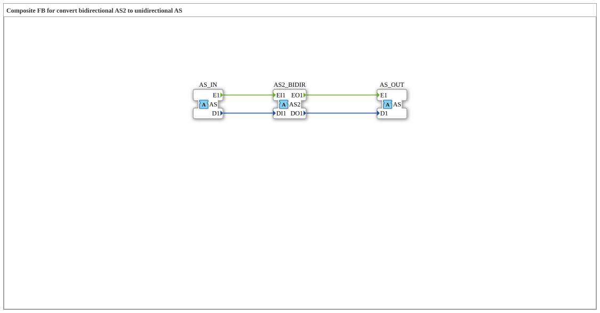

# AS2_TO_AS

* * * * * * * * * *

## Introduction

The AS2_TO_AS function block is the mirror image of [AS_TO_AS2](AS_TO_AS2.md): here the bidirectional [AS2](../../../types/bidirectional/SINT/AS2.md) tap sits as a socket on the left (input) side, complemented by a second unidirectional [AS](../../../types/unidirectional/SINT/AS.md) socket and a unidirectional AS plug.

## Interface Structure

### **Event Inputs**

The function block has no direct event inputs — communication happens exclusively through the adapters.

### **Event Outputs**

The function block has no direct event outputs.

### **Data Inputs**

The function block has no direct data inputs.

### **Data Outputs**

The function block has no direct data outputs.

### **Adapters**

- **AS2_BIDIR** (Socket): bidirectional tap whose incoming side is forwarded to `AS_OUT` and whose outgoing side is fed by `AS_IN`, of type `adapter::types::bidirectional::AS2`
- **AS_IN** (Socket): unidirectional SINT source, of type `adapter::types::unidirectional::AS`
- **AS_OUT** (Plug): mirrors the incoming (indication) side of `AS2_BIDIR` as a unidirectional signal, of type `adapter::types::unidirectional::AS`

## Functionality

The block operates in two directions at once: whatever the socket `AS2_BIDIR` receives on its indication side (`EO1`/`DO1` — i.e. whatever a bidirectional peer attached to AS2_BIDIR reports) is output unchanged as a standalone unidirectional signal via the plug `AS_OUT`. Conversely, whatever arrives at the socket `AS_IN` (`E1`/`D1`) is published onto the request side of `AS2_BIDIR` (`EI1`/`DI1`) — so AS2_BIDIR forwards the same signal to the attached bidirectional peer.

## Technical Details

- Three adapters instead of two: the direction received from the tap and the separately injected direction are deliberately kept apart rather than mixed
- Pure wiring, no logic or state, every destination variable has exactly one writer
- `AS_OUT` only reflects what is reported via `AS2_BIDIR` by an attached bidirectional peer — without such a peer, `AS_OUT` stays idle

## State Overview

The block is stateless:

- AS2_BIDIR.EO1 → AS_OUT.E1, AS2_BIDIR.DO1 → AS_OUT.D1
- AS_IN.E1 → AS2_BIDIR.EI1, AS_IN.D1 → AS2_BIDIR.DI1

## Application Scenarios

- Reading the status of a bidirectional AS2 peer as a plain unidirectional AS signal, combined with injecting a separate unidirectional command signal
- Systems where a bidirectional peer needs to be monitored without converting the rest of the control logic to AS2
- Bridging a bidirectional AS2 zone and a unidirectional AS zone

## ⚖️ Comparison with Similar Blocks

[AS_TO_AS2](AS_TO_AS2.md) is the mirror image of this block — there, `AS2_BIDIR` sits as a plug on the right side.

## Conclusion

AS2_TO_AS is not a simple converter but a tap point: it makes the state of a bidirectional AS2 peer visible as a standalone unidirectional AS signal while simultaneously injecting a separate unidirectional signal into the bidirectional side.
