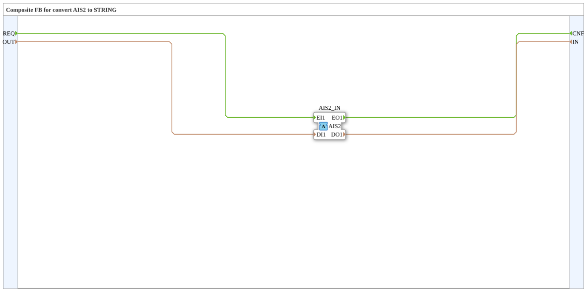

# AIS2_S_TO_STRING

* * * * * * * * * *

## Introduction

`AIS2_S_TO_STRING` is a composite function block that maps the bidirectional adapter [AIS2](../../../types/bidirectional/STRING/AIS2.md) onto plain event and STRING data ports. It belongs to the conversion family analogous to AR2/AB2/AE2.

## Interface Structure

### **Event Inputs**

- **REQ** (Request to Adapter): Sends the data `OUT` through the adapter (associated with `OUT`)

### **Event Outputs**

- **CNF** (Confirmation from Adapter): Triggered when the adapter delivers an event on its incoming side (associated with `IN`)

### **Data Inputs**

- **OUT** (STRING): Data sent to the adapter

### **Data Outputs**

- **IN** (STRING): Data received from the adapter

### **Adapters**

- **AIS2_IN** (Socket): Adapter of type `adapter::types::bidirectional::AIS2`

## Functionality

The block consists of wiring only, without any logic of its own:

- `REQ` → `AIS2_IN.EI1` and `OUT` → `AIS2_IN.DI1`: The request event stream together with its data is published onto the outgoing side of the adapter.
- `AIS2_IN.EO1` → `CNF` and `AIS2_IN.DO1` → `IN`: Whatever is reported on the incoming side of the adapter appears as event `CNF` with the data `IN`.

## Technical Details

- Stateless composite block without algorithms
- Every destination variable has exactly one writer
- The adapter data is passed through unchanged, no value conversion takes place

## Application Scenarios

- Connecting classic event/data ports to a bidirectional AIS2 adapter
- Integrating blocks with STRING ports into adapter-based networks

## Conclusion

`AIS2_S_TO_STRING` maps the bidirectional AIS2 adapter onto the ports `REQ`/`OUT` and `CNF`/`IN` without any logic.
