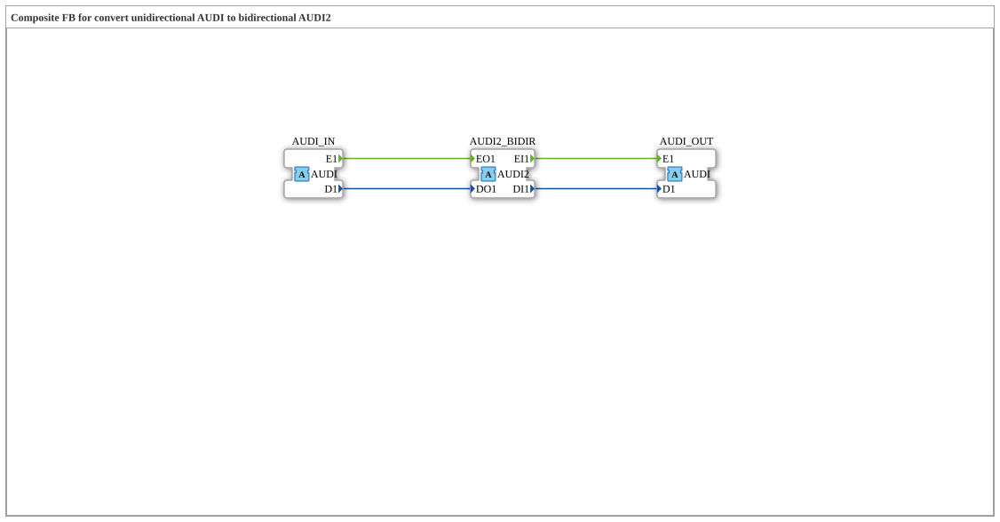

# AUDI_TO_AUDI2

* * * * * * * * * *

## Introduction

The `AUDI_TO_AUDI2` function block inserts a bidirectional [`AUDI2`](../../../types/bidirectional/UDINT/AUDI2.md) tap into a unidirectional [`AUDI`](../../../types/unidirectional/UDINT/AUDI.md) chain (UDINT). It uses **three** adapters: an incoming unidirectional AUDI signal is published onto the bidirectional AUDI2 interface, and whatever AUDI2 returns on its request side is output again as a standalone unidirectional AUDI signal.

## Interface Structure

### **Event Inputs**

The function block has no direct event inputs.

### **Event Outputs**

The function block has no direct event outputs.

### **Data Inputs**

The function block has no direct data inputs.

### **Data Outputs**

The function block has no direct data outputs.

### **Adapters**

- **AUDI_IN** (socket): unidirectional UDINT source, type `adapter::types::unidirectional::AUDI`
- **AUDI2_BIDIR** (plug): bidirectional tap whose outgoing side is fed by `AUDI_IN` and whose incoming side is forwarded to `AUDI_OUT`, type `adapter::types::bidirectional::AUDI2`
- **AUDI_OUT** (plug): mirrors the incoming (request) side of `AUDI2_BIDIR` as a unidirectional signal, type `adapter::types::unidirectional::AUDI`

## Functionality

The block operates in two directions at once: whatever arrives at the socket `AUDI_IN` (`E1`/`D1`) is published directly onto the outgoing side of `AUDI2_BIDIR` (`EO1`/`DO1`). Conversely, whatever `AUDI2_BIDIR` receives on its request side (`EI1`/`DI1`) is output unchanged as a standalone unidirectional signal via the plug `AUDI_OUT`. `AUDI2_BIDIR` thus acts as a tap point that does not break the unidirectional chain but extends it with a bidirectional observation/injection point.

## Technical Details

- Three adapters instead of two: the incoming signal direction and the direction coming back from the tap are deliberately kept separate
- Pure wiring, no logic or state, every destination variable has exactly one writer
- `AUDI_OUT` only reflects what comes back via `AUDI2_BIDIR` from an attached bidirectional peer; without such a peer, `AUDI_OUT` stays idle

## State Overview

The block is stateless:

- AUDI_IN.E1 → AUDI2_BIDIR.EO1, AUDI_IN.D1 → AUDI2_BIDIR.DO1
- AUDI2_BIDIR.EI1 → AUDI_OUT.E1, AUDI2_BIDIR.DI1 → AUDI_OUT.D1

## Application Scenarios

- Retrofitting a bidirectional diagnostic or control point into an existing unidirectional AUDI signal chain without breaking it
- Bridging a unidirectional AUDI zone and a bidirectional AUDI2 zone

## ⚖️ Comparison with Similar Blocks

The counterpart in the opposite direction is the block `AUDI2_TO_AUDI` (there, `AUDI2_BIDIR` is a socket on the left side). The blocks of this conversion family exist analogously for the adapters `AR`/`AR2`, `AB`/`AB2` and `AE`/`AE2`.

## Conclusion

`AUDI_TO_AUDI2` is not a simple converter but a tap point: it makes a unidirectional AUDI signal visible at a bidirectional AUDI2 point without breaking the original signal chain, while forwarding the request signal received there as a standalone AUDI signal.
