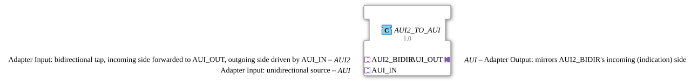

# AUI2_TO_AUI

* * * * * * * * * *

## Introduction

`AUI2_TO_AUI` is a composite function block that converts a **bidirectional** `AUI2` adapter into a **unidirectional** `AUI` adapter. The incoming side (`EO1`/`DO1`) of the bidirectional adapter is output as a plain unidirectional signal via `AUI_OUT`; via `AUI_IN` a value is written onto the outgoing side (`EI1`/`DI1`) of the bidirectional adapter.

## Interface Structure

### **Event Inputs**

*No direct event inputs - events arrive via the adapter sockets/plugs*

### **Event Outputs**

*No direct event outputs*

### **Data Inputs**

*No data inputs*

### **Data Outputs**

*No data outputs*

### **Adapters**

- **AUI2_BIDIR** (socket): Bidirectional adapter of type `adapter::types::bidirectional::AUI2` - the incoming side is forwarded to `AUI_OUT`, the outgoing side is driven by `AUI_IN`
- **AUI_IN** (socket): Unidirectional adapter of type `adapter::types::unidirectional::AUI` - unidirectional source
- **AUI_OUT** (plug): Unidirectional adapter of type `adapter::types::unidirectional::AUI` - mirrors the incoming (indication) side of `AUI2_BIDIR`

## How it works

1. `AUI2_BIDIR.EO1` is forwarded to `AUI_OUT.E1` and `AUI2_BIDIR.DO1` to `AUI_OUT.D1`.
2. `AUI_IN.E1` is forwarded to `AUI2_BIDIR.EI1` and `AUI_IN.D1` to `AUI2_BIDIR.DI1`.

## Technical Details

- Pure event/data connections (`FBNetwork`), no logic of its own and no internal state
- Part of the conversion family (analogous to `AR2`/`AB2`/`AE2`)

## Application Scenarios

- Connecting a unidirectional `AUI` consumer or producer to a bidirectional `AUI2` adapter

## Summary

`AUI2_TO_AUI` separates the two directions of a bidirectional `AUI2` adapter into a unidirectional output (`AUI_OUT`) and a unidirectional input (`AUI_IN`).
