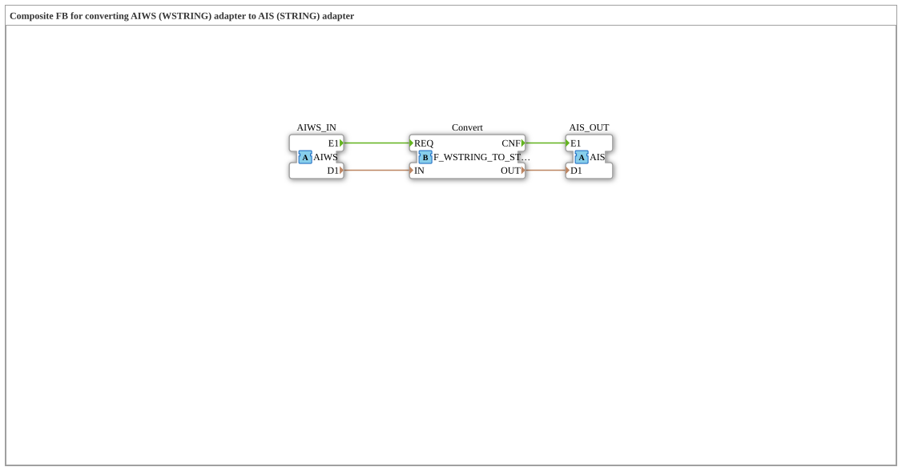

# AIWS_TO_AIS

* * * * * * * * * *

!!! warning "Not released yet"
    The block is defined as a type in the library (as of 2026-11-13). The matching firmware side (C++ and ELF libraries) has not been released yet. Do not assume it is runnable yet.

## Introduction

`AIWS_TO_AIS` is a composite block: Composite FB for converting AIWS (WSTRING) adapter to AIS (STRING) adapter.

## Interface structure

### **Event inputs**

No direct events.

### **Event outputs**

No direct events.

### **Data inputs**

No direct data.

### **Data outputs**

No direct data.

### **Adapters**

| Role | Name | Type | Description |
| --- | --- | --- | --- |
| Socket | AIWS_IN | adapter::types::unidirectional::AIWS | WSTRING Adapter Input |
| Plug | AIS_OUT | adapter::types::unidirectional::AIS | STRING Adapter Output |

## How it works

The connections are listed in the section “Connections inside the block”. Internally `iec61131::conversion::F_WSTRING_TO_STRING` is used.

## Connections inside the block

**Internal blocks:** `Convert` (`iec61131::conversion::F_WSTRING_TO_STRING`)

**Event connections:**

- `AIWS_IN.E1` → `Convert.REQ`
- `Convert.CNF` → `AIS_OUT.E1`

**Data connections:**

- `AIWS_IN.D1` → `Convert.IN`
- `Convert.OUT` → `AIS_OUT.D1`

## Technical notes

- Initial Version - Luecke in der Adapter-Familie geschlossen

## ⚖️ Comparison with similar blocks

Blocks of the same family are in the same folder or in the neighbouring folders of `conversion`.
