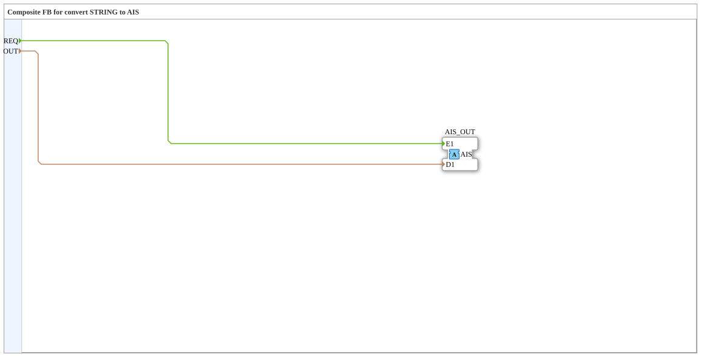

# AIS_STRING_TO_S

* * * * * * * * * *

!!! warning "Not released yet"
    The block is defined as a type in the library (as of 2026-11-13). The matching firmware side (C++ and ELF libraries) has not been released yet. Do not assume it is runnable yet.

## Introduction

`AIS_STRING_TO_S` is a composite block: Composite FB for convert STRING to AIS.

## Interface structure

### **Event inputs**

| Event | Type | With | Description |
| --- | --- | --- | --- |
| REQ | Event | OUT | Request to Adapter |

### **Event outputs**

No direct events.

### **Data inputs**

| Name | Type | Description |
| --- | --- | --- |
| OUT | STRING | Output data to Adapter |

### **Data outputs**

No direct data.

### **Adapters**

| Role | Name | Type | Description |
| --- | --- | --- | --- |
| Plug | AIS_OUT | adapter::types::unidirectional::AIS | Adapter Output |

## How it works

The connections are listed in the section “Connections inside the block”. There are no internal function blocks, the block only wires adapters and inputs/outputs.

## Connections inside the block

**Event connections:**

- `REQ` → `AIS_OUT.E1`

**Data connections:**

- `OUT` → `AIS_OUT.D1`

## Technical notes

- Initial Version - Luecke geschlossen (analog zu AB_BYTE_TO_B)

## ⚖️ Comparison with similar blocks

Blocks of the same family are in the same folder or in the neighbouring folders of `conversion`.
