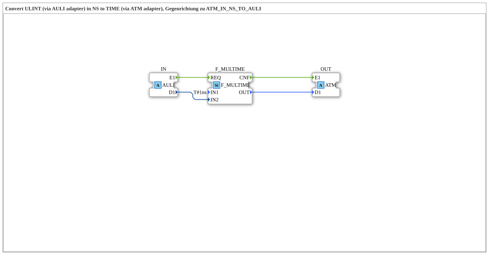

# AULI_TO_ATM_IN_NS

* * * * * * * * * *

!!! warning "Not released yet"
    The block is defined as a type in the library (as of 2026-11-13). The matching firmware side (C++ and ELF libraries) has not been released yet. Do not assume it is runnable yet.

## Introduction

`AULI_TO_ATM_IN_NS` converts a `ULINT` value (via the adapter `AULI`) into a `TIME` value (via the adapter `ATM`): **TIME = IN × 1 NS** (unit nanoseconds). It is the reverse direction of [ATM_IN_NS_TO_AULI](ATM_IN_NS_TO_AULI.md).

## Interface structure

### **Event inputs**

No direct events.

### **Event outputs**

No direct events.

### **Data inputs**

No direct data.

### **Data outputs**

No direct data.

### **Adapters**

| Role | Name | Type | Description |
| --- | --- | --- | --- |
| Socket | IN | adapter::types::unidirectional::AULI | Zeitwert in NS als ULINT |
| Plug | OUT | adapter::types::unidirectional::ATM | TIME-Wert = IN * 1 NS |

## How it works

Internally `F_MULTIME` (`iec61131::arithmetic::F_MULTIME`) multiplies the input value by one unit. Event and value run through the adapters, the connections are listed in the section “Connections inside the block”.

## Connections inside the block

**Internal blocks:** `F_MULTIME` (`iec61131::arithmetic::F_MULTIME`)

**Event connections:**

- `IN.E1` → `F_MULTIME.REQ`
- `F_MULTIME.CNF` → `OUT.E1`

**Data connections:**

- `IN.D1` → `F_MULTIME.IN2`
- `F_MULTIME.OUT` → `OUT.D1`

## Technical notes

- Composite with one internal function block (`F_MULTIME`).
- The input value is in nanoseconds (type `ULINT`), the result is a `TIME`.

## ⚖️ Comparison with similar blocks

- Same unit, other input type: [ADI_TO_ATM_IN_NS](ADI_TO_ATM_IN_NS.md), [ALI_TO_ATM_IN_NS](ALI_TO_ATM_IN_NS.md), [ALR_TO_ATM_IN_NS](ALR_TO_ATM_IN_NS.md), [AUDI_TO_ATM_IN_NS](AUDI_TO_ATM_IN_NS.md).
- Same type, other unit: [AULI_TO_ATM_IN_MS](AULI_TO_ATM_IN_MS.md), [AULI_TO_ATM_IN_S](AULI_TO_ATM_IN_S.md), [AULI_TO_ATM_IN_US](AULI_TO_ATM_IN_US.md).
- Reverse direction: [ATM_IN_NS_TO_AULI](ATM_IN_NS_TO_AULI.md).
