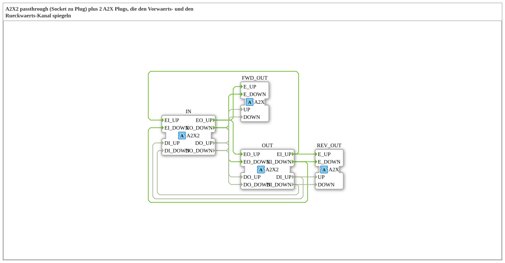

# A2X2_SPLIT_FWD_REV

* * * * * * * * * *

!!! warning "Not released yet"
    The block is defined as a type in the library (as of 2026-11-13). The matching firmware side (C++ and ELF libraries) has not been released yet. Do not assume it is runnable yet.

## Introduction

`A2X2_SPLIT_FWD_REV` passes the bidirectional adapter `A2X2` through from `IN` to `OUT` (passthrough) and additionally mirrors the **forward channel** to `FWD_OUT` and the **reverse channel** to `REV_OUT`. Both mirrors are unidirectional `A2X` adapters.

## Interface structure

### **Event inputs**

No direct events.

### **Event outputs**

No direct events.

### **Data inputs**

No direct data.

### **Data outputs**

No direct data.

### **Adapters**

| Role | Name | Type | Description |
| --- | --- | --- | --- |
| Socket | IN | adapter::types::bidirectional::A2X2 | bidirektionaler Eingang |
| Plug | OUT | adapter::types::bidirectional::A2X2 | bidirektionaler Ausgang (Passthrough) |
| Plug | FWD_OUT | adapter::types::unidirectional::A2X | spiegelt den Vorwaerts-Kanal (IN.EO*) |
| Plug | REV_OUT | adapter::types::unidirectional::A2X | spiegelt den Rueckwaerts-Kanal (OUT.EI*) |

## How it works

All connections are direct event and data connections, there is no logic of its own. The list is in the section “Connections inside the block”.

## Connections inside the block

**Event connections:**

- `IN.EO_UP` → `OUT.EO_UP`
- `IN.EO_UP` → `FWD_OUT.E_UP`
- `OUT.EI_UP` → `IN.EI_UP`
- `OUT.EI_UP` → `REV_OUT.E_UP`
- `IN.EO_DOWN` → `OUT.EO_DOWN`
- `IN.EO_DOWN` → `FWD_OUT.E_DOWN`
- `OUT.EI_DOWN` → `IN.EI_DOWN`
- `OUT.EI_DOWN` → `REV_OUT.E_DOWN`

**Data connections:**

- `IN.DO_UP` → `OUT.DO_UP`
- `IN.DO_UP` → `FWD_OUT.UP`
- `OUT.DI_UP` → `IN.DI_UP`
- `OUT.DI_UP` → `REV_OUT.UP`
- `IN.DO_DOWN` → `OUT.DO_DOWN`
- `IN.DO_DOWN` → `FWD_OUT.DOWN`
- `OUT.DI_DOWN` → `IN.DI_DOWN`
- `OUT.DI_DOWN` → `REV_OUT.DOWN`

## Technical notes

- Pure wiring block (composite without internal function blocks).
- The mirror is used to tap a channel without disturbing the passthrough.

## ⚖️ Comparison with similar blocks

- Same family: [AB2_SPLIT_FWD_REV](../AB2_SPLIT_FWD_REV.md) and others in the parent folder.
