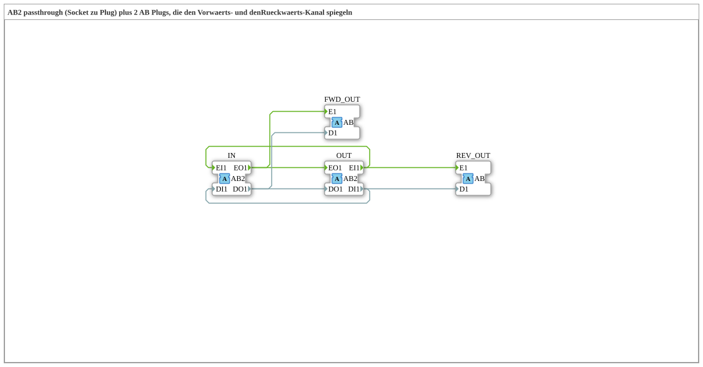

# AB2_SPLIT_FWD_REV

* * * * * * * * * *

## Introduction

`AB2_SPLIT_FWD_REV` is a composite function block that passes a bidirectional `AB2` adapter from socket `IN` unchanged through to plug `OUT` (passthrough) and additionally mirrors the forward and the backward channel onto two separate, unidirectional `AB` plugs. This allows both directions of an `AB2` connection to be tapped elsewhere without altering the connection itself.

## Interface Structure

### **Event Inputs**

*No direct event inputs - events arrive via the adapter sockets/plugs*

### **Event Outputs**

*No direct event outputs*

### **Data Inputs**

*No data inputs*

### **Data Outputs**

*No data outputs*

### **Adapters**

- **IN** (socket): Bidirectional adapter of type `adapter::types::bidirectional::AB2` (bidirectional input)
- **OUT** (plug): Bidirectional adapter of type `adapter::types::bidirectional::AB2` (bidirectional output, passthrough)
- **FWD_OUT** (plug): Unidirectional adapter of type `adapter::types::unidirectional::AB`, mirrors the forward channel (`IN.EO1`/`DO1`)
- **REV_OUT** (plug): Unidirectional adapter of type `adapter::types::unidirectional::AB`, mirrors the backward channel (`OUT.EI1`/`DI1`)

## How it works

1. **Forward (indication)**: `IN.EO1`/`IN.DO1` is forwarded unchanged to `OUT.EO1`/`OUT.DO1` and additionally mirrored to `FWD_OUT.E1`/`FWD_OUT.D1`.
2. **Backward (request)**: `OUT.EI1`/`OUT.DI1` is forwarded unchanged to `IN.EI1`/`IN.DI1` and additionally mirrored to `REV_OUT.E1`/`REV_OUT.D1`.

## Technical Details

- Pure event/data connections (`FBNetwork`), no logic of its own and no internal state
- Each passthrough event output feeds two targets (fan-out); the data runs in parallel with the events
- The two mirror plugs are unidirectional (`AB`) and therefore provide read access to the respective channel only

## Application Scenarios

- Monitoring/diagnosing both directions of a bidirectional `AB2` connection
- Splitting an `AB2` connection into a separately evaluable forward and backward stream without interrupting the main connection

## Summary

`AB2_SPLIT_FWD_REV` passes a bidirectional `AB2` connection through transparently and additionally provides the forward and backward channels as separate `AB` adapters.
