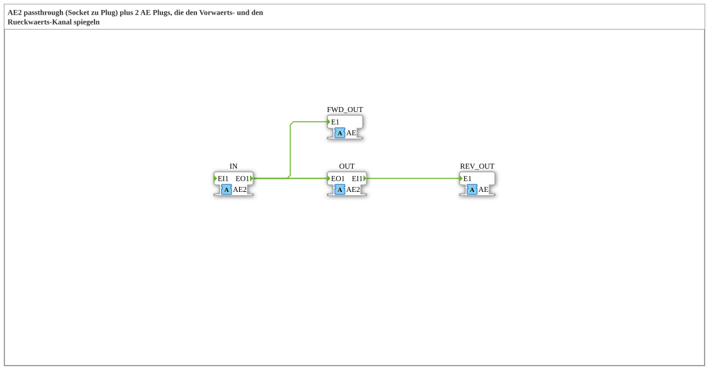

# AE2_SPLIT_FWD_REV

* * * * * * * * * *

!!! warning "Not released yet"
    The block is defined as a type in the library (as of 2026-11-13). The matching firmware side (C++ and ELF libraries) has not been released yet. Do not assume it is runnable yet.

## Introduction

`AE2_SPLIT_FWD_REV` passes the bidirectional adapter `AE2` through from `IN` to `OUT` (passthrough) and additionally mirrors the **forward channel** to `FWD_OUT` and the **reverse channel** to `REV_OUT`. Both mirrors are unidirectional `AE` adapters.

## Interface structure

### **Event inputs**

No direct events.

### **Event outputs**

No direct events.

### **Data inputs**

No direct data.

### **Data outputs**

No direct data.

### **Adapters**

| Role | Name | Type | Description |
| --- | --- | --- | --- |
| Socket | IN | adapter::types::bidirectional::AE2 | bidirektionaler Eingang |
| Plug | OUT | adapter::types::bidirectional::AE2 | bidirektionaler Ausgang (Passthrough) |
| Plug | FWD_OUT | adapter::types::unidirectional::AE | spiegelt den Vorwaerts-Kanal (IN.EO*) |
| Plug | REV_OUT | adapter::types::unidirectional::AE | spiegelt den Rueckwaerts-Kanal (OUT.EI*) |

## How it works

All connections are direct event and data connections, there is no logic of its own. The list is in the section “Connections inside the block”.

## Connections inside the block

**Event connections:**

- `IN.EO1` → `OUT.EO1`
- `IN.EO1` → `FWD_OUT.E1`
- `OUT.EI1` → `IN.EI1`
- `OUT.EI1` → `REV_OUT.E1`

## Technical notes

- Pure wiring block (composite without internal function blocks).
- The mirror is used to tap a channel without disturbing the passthrough.

## ⚖️ Comparison with similar blocks

- Same family: [AB2_SPLIT_FWD_REV](../AB2_SPLIT_FWD_REV.md) and others in the parent folder.
