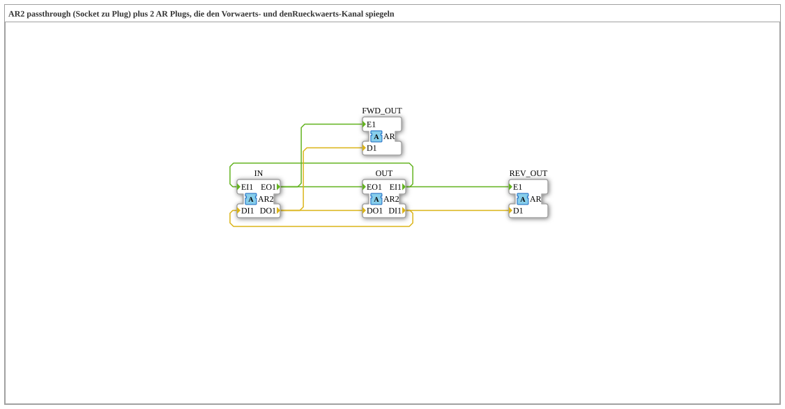

# AR2_SPLIT_FWD_REV

* * * * * * * * * *

## Introduction

The `AR2_SPLIT_FWD_REV` function block passes a bidirectional [`AR2`](../../types/bidirectional/REAL/AR2.md) adapter unchanged from `IN` (socket) to `OUT` (plug) and additionally mirrors both channels onto one unidirectional [`AR`](../../types/unidirectional/REAL/AR.md) plug each: the forward channel (indication, `IN.EO1`/`DO1`) onto `FWD_OUT` and the backward channel (request, `OUT.EI1`/`DI1`) onto `REV_OUT`. This allows both directions of a bidirectional AR2 connection to be tapped separately as plain AR signals.

## Interface Structure

### **Event Inputs**

The function block has no direct event inputs.

### **Event Outputs**

The function block has no direct event outputs.

### **Data Inputs**

The function block has no direct data inputs.

### **Data Outputs**

The function block has no direct data outputs.

### **Adapters**

- **IN** (socket): bidirectional input, type `adapter::types::bidirectional::AR2`
- **OUT** (plug): bidirectional output (passthrough), type `adapter::types::bidirectional::AR2`
- **FWD_OUT** (plug): mirrors the forward channel (`IN.EO1`/`DO1`), type `adapter::types::unidirectional::AR`
- **REV_OUT** (plug): mirrors the backward channel (`OUT.EI1`/`DI1`), type `adapter::types::unidirectional::AR`

## Functionality

The block consists of wiring only:

- **Forward** (indication): `IN.EO1` → `OUT.EO1` and additionally `IN.EO1` → `FWD_OUT.E1`; `IN.DO1` → `OUT.DO1` and additionally `IN.DO1` → `FWD_OUT.D1`.
- **Backward** (request): `OUT.EI1` → `IN.EI1` and additionally `OUT.EI1` → `REV_OUT.E1`; `OUT.DI1` → `IN.DI1` and additionally `OUT.DI1` → `REV_OUT.D1`.

Both directions therefore pass through unchanged, and each one is additionally output as a plain unidirectional AR signal.

## Technical Details

- Pure wiring without logic or state
- The passthrough `IN` → `OUT` is fully preserved; `FWD_OUT` and `REV_OUT` are pure observation taps
- Each source is fanned out to two destinations (event and data); the behaviour corresponds to a split onto both branches

## Application Scenarios

- Monitoring the forward and the backward direction of a AR2 connection (e.g. for display, logging or diagnostics) without altering the connection itself
- Separate further processing of indication and request as plain AR signals

## ⚖️ Comparison with Similar Blocks

The same structure exists for further bidirectional adapters, e.g. `AR2_SPLIT_FWD_REV`, `AS2_SPLIT_FWD_REV`, `AX2_SPLIT_FWD_REV`, `AIS2_SPLIT_FWD_REV` and `ALR2_SPLIT_FWD_REV`; they differ only in the data type of the adapter.

## Conclusion

`AR2_SPLIT_FWD_REV` is a stateless passthrough for AR2 that additionally mirrors the forward and backward channels onto two unidirectional AR plugs.
