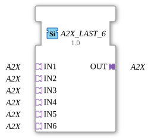

# A2X_LAST_6

## Introduction

The function block `A2X_LAST_6` merges 6 identical `A2X` adapter signals (**IN1** to **IN6**) into one common output (**OUT**) following the **last writer wins** principle, separately for the channels UP and DOWN: on each channel the socket that sent an event last wins, and its value is passed to OUT immediately.

## Interface Structure

### **Adapters**

**Input adapters (sockets):**

- **IN1**: A2X adapter (unidirectional)
- **IN2**: A2X adapter (unidirectional)
- **IN3**: A2X adapter (unidirectional)
- **IN4**: A2X adapter (unidirectional)
- **IN5**: A2X adapter (unidirectional)
- **IN6**: A2X adapter (unidirectional)

**Output adapter (plug):**

- **OUT**: A2X adapter (unidirectional), merged signal

## Functionality

The socket with the last event wins, separately for UP and DOWN: the two channels run independently. OUT takes over the value of the winner immediately and sends the event, even if the value stays the same.

## Technical Features

- Generic function block without ECC (`GenericClassName` = `GEN_A2X_LAST`); the behavior is implemented in the firmware (FORTE), the type description contains no algorithm.
- Interface: sockets `IN1` to `IN6`, plug `OUT`.
- All sizes `A2X_LAST_2` to `A2X_LAST_9` have the same function and differ only in the number of sockets.
- The library version stays 3.0.0. A new FORTE or `adapter_events` ELF is required; otherwise `A2X_LAST_3` and above counts as an unknown type (statement from development, not verified).
- Status: according to development, `AD_LAST_3` is tested on hardware (Trainer20, ESP32-S31); the other types and sizes are not.

## Application Scenarios

- Merging equivalent signal sources into one downstream adapter path, for example a manual and an automatic setpoint source.
- Arbitration between several operator stations that may write the same value.
- Simplifying networks that would otherwise wire `F_SEL`/`E_RS` inline.
