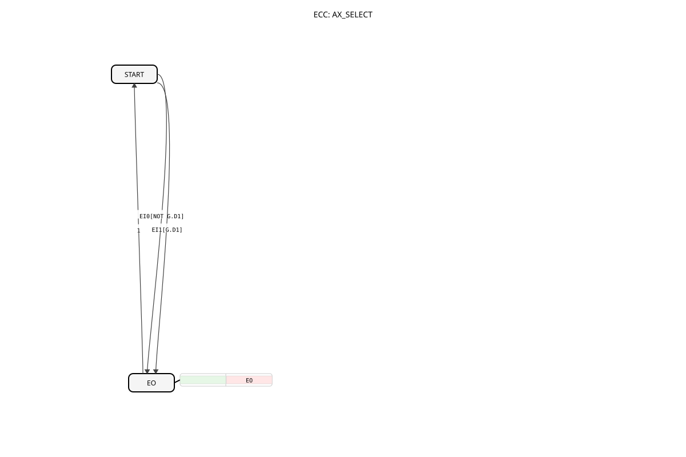

# AX_SELECT

* * * * * * * * * *

## Introduction

The AX_SELECT function block, based on a Boolean input, switches one of two AX adapter inputs to the output.

## Interface Structure

### **Event Inputs**

- **EI0**: Input event, selected when G = 0.
- **EI1**: Input event, selected when G = 1.

### **Event Outputs**

- **EO**: Output event.

### **Adapters**

**Sockets (Inputs):**

- **G** (adapter::types::unidirectional::AX): Selection signal. EI0 is selected when G = 0, EI1 when G = 1.

## Functionality

If G = 0, the event EI0 is output as EO.

If G = 1, the event EI1 is output as EO.

## Technical Features

- Uses unidirectional adapters.

## State Overview

Combinatorial.

## Application Scenarios

Selection of signals.

## ⚖️ Comparison with Similar Function Blocks

- **E_SELECT**: Standard event select without adapters.

## 🛠️ Related Exercises

- [Exercise_095_AX](https://meisterschulen-am-ostbahnhof-munchen-docs.readthedocs.io/projects/4diac-exercises-docs/en/latest/Uebungen/test_AX/Uebungen_doc/Uebung_095_AX/)

## Conclusion

Adapter-based select function block.
