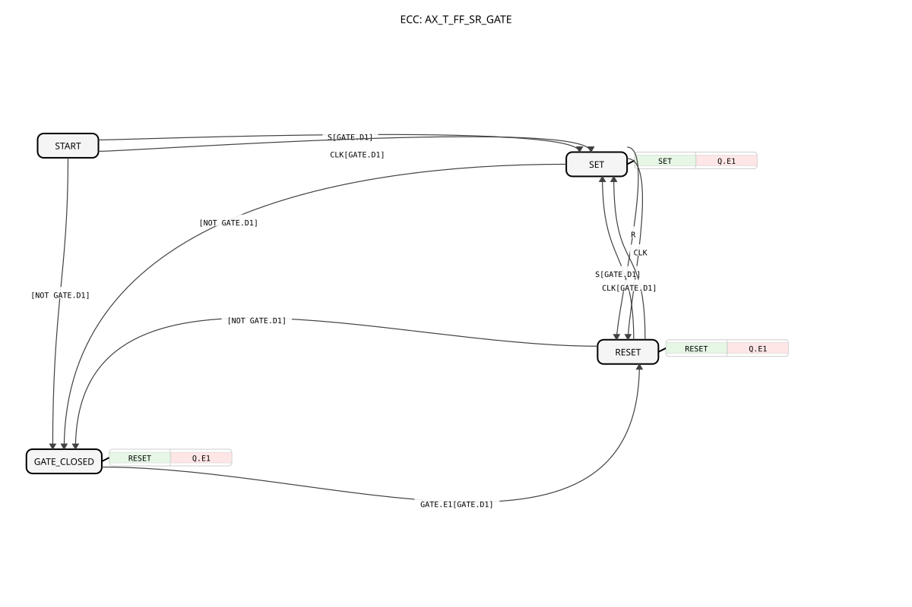

# AX_T_FF_SR_GATE

* * * * * * * * * *

## Introduction

`AX_T_FF_SR_GATE` corresponds to [`AX_T_FF_SR`](./AX_T_FF_SR.md), but additionally has an enable socket `GATE` (`AX`) and a state of its own, `GATE_CLOSED`, without chaining (no `CHAIN_IN`/`CHAIN_OUT`). It is suited for cases where only the gate lock is needed but no chain delay; for the chained variant see [`AX_T_FF_SR_SEQ_GATE`](./AX_T_FF_SR_SEQ_GATE.md).

## Interface Structure

### **Event Inputs**

- **S**: Sets the output `Q` - no effect during `GATE_CLOSED`
- **R**: Resets the output `Q` - no effect during `GATE_CLOSED` (it is off there anyway)
- **CLK**: Clock for toggling the output - no effect during `GATE_CLOSED`

### **Event Outputs**

No direct event outputs - the event is output via `Q.E1`.

### **Data Inputs / Data Outputs**

None.

### **Adapters**

- **Q** (plug, `adapter::types::unidirectional::AX`): Value of the flip-flop
- **GATE** (socket, `adapter::types::unidirectional::AX`): Enable, must be `TRUE`. If `GATE` falls to `FALSE`, the block immediately enters `GATE_CLOSED` (forced reset and lock); this state is left only via `GATE.E1[GATE.D1]`

## How it works

States and actions:

- **START**: Initial state
- **SET**: Algorithm `SET` (`Q.D1 := TRUE`), output `Q.E1`
- **RESET**: Algorithm `RESET` (`Q.D1 := FALSE`), output `Q.E1`
- **GATE_CLOSED**: locked (`GATE.D1 = FALSE`), `Q` forced to `FALSE` (algorithm `RESET`, output `Q.E1`); `S`/`R`/`CLK` have no effect here

Transitions (in declaration order):

| From | To | Condition |
| :--- | :--- | :--- |
| START | GATE_CLOSED | `[NOT GATE.D1]` |
| START | SET | `S[GATE.D1]` |
| START | SET | `CLK[GATE.D1]` |
| SET | GATE_CLOSED | `[NOT GATE.D1]` |
| SET | RESET | `R` |
| SET | RESET | `CLK` |
| RESET | GATE_CLOSED | `[NOT GATE.D1]` |
| RESET | SET | `S[GATE.D1]` |
| RESET | SET | `CLK[GATE.D1]` |
| GATE_CLOSED | RESET | `GATE.E1[GATE.D1]` |

## Technical Details

- **Lock first**: `[NOT GATE.D1]` comes first in the declaration order of every state. Since `S`/`CLK` without a guard are always `TRUE`, according to IEC 61499-1 Table 1 rule c) the gate lock would otherwise never take effect (bugfix v1.2). If the gate is open, the guard is `FALSE` and is skipped
- **Boot window**: The event-less transition `START` → `GATE_CLOSED` is evaluated immediately on entering `START` and covers the state before a `GATE.E1` has ever fired (v1.1)
- From `GATE_CLOSED` the block returns only to `RESET`, so `Q` stays `FALSE` until `S` or `CLK` takes effect
- Copy of `AX_T_FF_SR` with `GATE` socket and state `GATE_CLOSED`, same pattern as `AX_T_FF_SR_SEQ_GATE`

## Application Scenarios

- Toggle/set-reset output that must be forcibly locked by an enable (e.g. safety or operating enable)

## Summary

`AX_T_FF_SR_GATE` is a toggle/SR flip-flop with enable: if `GATE` is `FALSE`, `Q` is reset and all inputs remain without effect until the enable returns.
