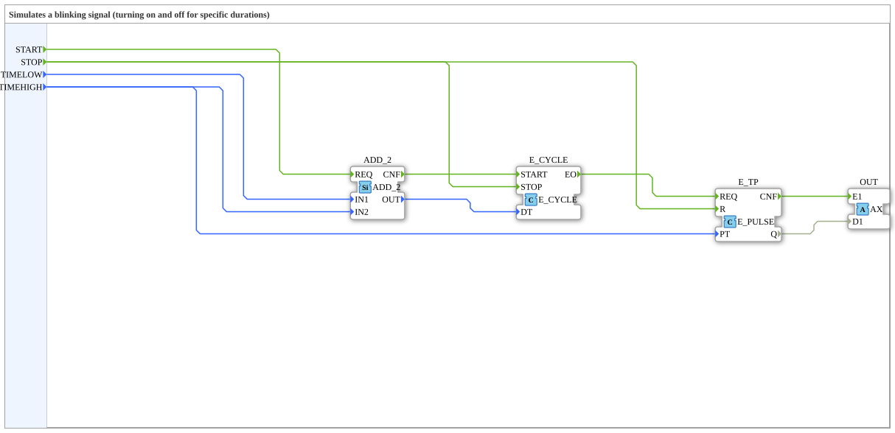

# AX_BLINK

* * * * * * * * * *

## Introduction

The AX_BLINK is a function block that outputs a flashing signal via an AX adapter.

## Interface Structure

### **Event Inputs**

- **START**: Starts the periodic generation of events; carries `TIMELOW` and `TIMEHIGH`.
- **STOP**: Stops the generation of events.

### **Data Inputs**

- **TIMELOW** (TIME): Time for OUT to be FALSE.
- **TIMEHIGH** (TIME): Time for OUT to be TRUE.

### **Adapters**

**Plugs (Outputs):**

- **OUT** (adapter::types::unidirectional::AX): Output value, starts with FALSE and switches between TRUE and FALSE for the given high and low times.

## Functionality

After `START`, the function block alternately switches the output OUT off (FALSE) for the time `TIMELOW` and on (TRUE) for the time `TIMEHIGH`, until `STOP` arrives.

## Technical Features

- Uses unidirectional adapters.

## State Overview

State-based (flashing).

## Application Scenarios

Flashing displays.

## ⚖️ Comparison with Similar Function Blocks

- **E_BLINK**: Standard flashing function block.

## 🛠️ Related Exercises

- [Exercise_020f3_AX](https://meisterschulen-am-ostbahnhof-munchen-docs.readthedocs.io/projects/4diac-exercises-docs/en/latest/Uebungen/test_AX/Uebungen_doc/Uebung_020f3_AX/)

## Conclusion

Adapter-based blink module.
