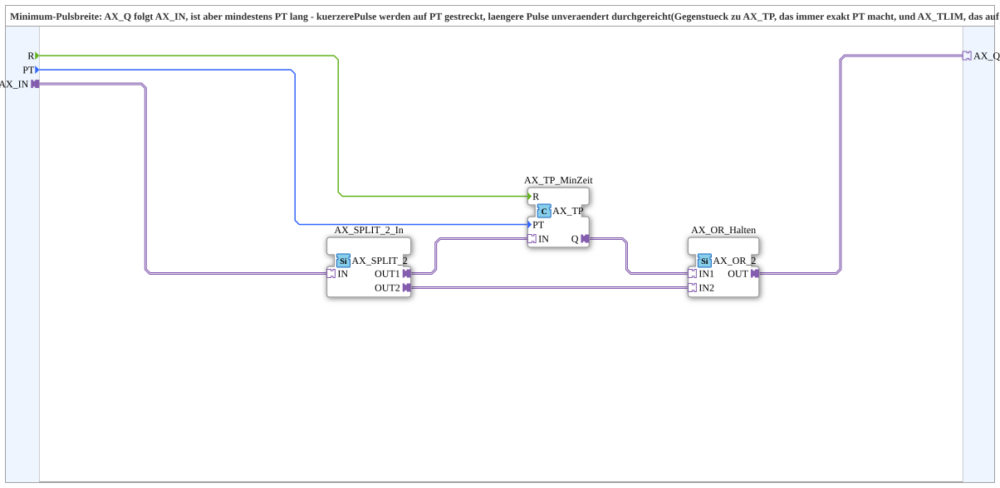

# AX_MIN_TP

* * * * * * * * * *

## Introduction

`AX_MIN_TP` is a minimum pulse width block: `AX_Q` follows `AX_IN`, but is **at least `PT` long**. Shorter pulses are stretched to `PT`, longer pulses are passed through unchanged. It is the counterpart of [`AX_TP`](./AX_TP.md), which always outputs exactly `PT`, and of [`AX_TLIM`](./AX_TLIM.md), which caps at a maximum of `PT`. Use case: the hopper floor lead-in in automatic mode needs a minimum time.

**Safety note (Martin Schuder):** The block itself has **no hard abort**. A limit switch that is to interrupt the pulse immediately at any time must be combined externally via `AX_AND(AX_Q, NOT limit switch)` **after** this block.

## Function Blocks (FBs) Used

### Sub-blocks: AX_MIN_TP

- **Type**: SubAppType
- **Internal FBs used**:
    - **AX_SPLIT_2_In**: `adapter::events::unidirectional::AX_SPLIT_2` - `AX_IN` is needed for `AX_TP_MinZeit.IN` **and** directly for `AX_OR_Halten`
    - **AX_TP_MinZeit**: `adapter::events::unidirectional::timers::AX_TP` - non-retriggerable: after the rising edge of `AX_IN` it always runs exactly `PT`, regardless of whether `AX_IN` drops again earlier
    - **AX_OR_Halten**: `adapter::booleanOperators::AX_OR_2` - `AX_IN OR AX_TP_MinZeit.Q`: holds the output as long as either the raw pulse is still present (longer pulses) or the minimum time is still running (shorter pulses)

## Interface Structure

### **Event Inputs**

- **R**: Reset (passed through to `AX_TP_MinZeit.R`)

### **Event Outputs**

None - events travel via the adapters.

### **Data Inputs**

- **PT** (`TIME`): Minimum pulse width

### **Data Outputs**

None.

### **Adapters**

- **AX_IN** (socket, `adapter::types::unidirectional::AX`): Raw input pulse
- **AX_Q** (plug, `adapter::types::unidirectional::AX`): Output stretched to at least `PT`

## Program Flow and Connections

- `AX_IN` → `AX_SPLIT_2_In.IN`
- `AX_SPLIT_2_In.OUT1` → `AX_TP_MinZeit.IN`
- `AX_SPLIT_2_In.OUT2` → `AX_OR_Halten.IN2`
- `AX_TP_MinZeit.Q` → `AX_OR_Halten.IN1`
- `AX_OR_Halten.OUT` → `AX_Q`
- `PT` → `AX_TP_MinZeit.PT`; `R` → `AX_TP_MinZeit.R`

## Technical Details

- No latch and no `AX_TON` needed: `AX_TP` is non-retriggerable, hence `AX_Q = AX_IN OR AX_TP_MinZeit.Q`
- Shorter pulses are stretched (`AX_TP.Q` holds until `PT`), longer ones remain unchanged (`AX_IN` keeps `Q` high even after `AX_TP.Q` has expired)
- Version 1.2 (2026-09-29): simplification compared to v1.1 (`ACTIVE`/`AX_TON`/`AX_R_TRIG` latch construction, discarded); new event input `R`

## Application Scenarios

- Minimum run time for a drive (e.g. hopper floor lead-in in automatic mode)
- Stretching pulses that are too short

## Summary

`AX_MIN_TP` outputs an `AX` pulse of at least `PT` length by ORing the input with a non-retriggerable `AX_TP`.
