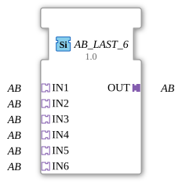

# AB_LAST_6

## Introduction

The function block `AB_LAST_6` merges 6 identical `BYTE` adapter signals (**IN1** to **IN6**) into one common output (**OUT**) following the **last writer wins** principle: the socket that sent an event last wins, and its value is passed to OUT immediately. This is pure arbitration by order in time, not a combination of the values.

## Interface Structure

### **Adapters**

**Input adapters (sockets):**

- **IN1**: BYTE adapter (unidirectional)
- **IN2**: BYTE adapter (unidirectional)
- **IN3**: BYTE adapter (unidirectional)
- **IN4**: BYTE adapter (unidirectional)
- **IN5**: BYTE adapter (unidirectional)
- **IN6**: BYTE adapter (unidirectional)

**Output adapter (plug):**

- **OUT**: BYTE adapter (unidirectional), merged signal

## Functionality

The socket with the last event wins. OUT takes over its value immediately and sends the adapter event, even if the value stays the same. There is no fixed priority, only the order in time.

## Technical Features

- Generic function block without ECC (`GenericClassName` = `GEN_AB_LAST`); the behavior is implemented in the firmware (FORTE), the type description contains no algorithm.
- Interface: sockets `IN1` to `IN6`, plug `OUT`.
- All sizes `AB_LAST_2` to `AB_LAST_9` have the same function and differ only in the number of sockets.
- The library version stays 3.0.0. A new FORTE or `adapter_events` ELF is required; otherwise `AB_LAST_3` and above counts as an unknown type (statement from development, not verified).
- Status: according to development, `AD_LAST_3` is tested on hardware (Trainer20, ESP32-S31); the other types and sizes are not.

## Application Scenarios

- Merging equivalent signal sources into one downstream adapter path, for example a manual and an automatic setpoint source.
- Arbitration between several operator stations that may write the same value.
- Simplifying networks that would otherwise wire `F_SEL`/`E_RS` inline.
