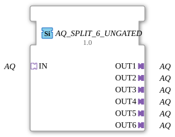

# AQ_SPLIT_6_UNGATED

* * * * * * * * * *

!!! warning "Not released yet"
    The block is defined as a type in the library (as of 2026-11-13). The matching firmware side (C++ and ELF libraries) has not been released yet. Do not assume it is runnable yet.

## Introduction

`AQ_SPLIT_6_UNGATED` distributes **one** AQ adapter to 6 identical adapter outputs. The block is generic (`GEN_AQ_SPLIT`).

## Interface structure

### **Event inputs**

No direct events.

### **Event outputs**

No direct events.

### **Data inputs**

No direct data.

### **Data outputs**

No direct data.

### **Adapters**

| Role | Name | Type | Description |
| --- | --- | --- | --- |
| Socket | IN | adapter::types::unidirectional::AQ |  |
| Plug | OUT1 | adapter::types::unidirectional::AQ |  |
| Plug | OUT2 | adapter::types::unidirectional::AQ |  |
| Plug | OUT3 | adapter::types::unidirectional::AQ |  |
| Plug | OUT4 | adapter::types::unidirectional::AQ |  |
| Plug | OUT5 | adapter::types::unidirectional::AQ |  |
| Plug | OUT6 | adapter::types::unidirectional::AQ |  |

## How it works

The `_UNGATED` variant has **no change detection**: every incoming event is passed to all 6 outputs unconditionally. It is meant for consumers that need a periodic cadence regardless of value changes, for example derivative or frequency calculations.

## Technical notes

- Generic block (`GenericClassName` = `GEN_AQ_SPLIT`), no network definition of its own in the type.
- The implementation is in the firmware (C++), not in the type.

## ⚖️ Comparison with similar blocks

- Other number of outputs: [AQ_SPLIT_5_UNGATED](AQ_SPLIT_5_UNGATED.md), [AQ_SPLIT_7_UNGATED](AQ_SPLIT_7_UNGATED.md), [AQ_SPLIT_8_UNGATED](AQ_SPLIT_8_UNGATED.md), [AQ_SPLIT_9_UNGATED](AQ_SPLIT_9_UNGATED.md).
- With or without change detection: [AQ_SPLIT_6](AQ_SPLIT_6.md).
