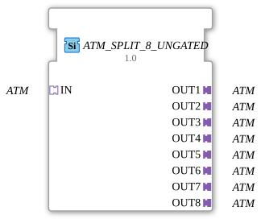

# ATM_SPLIT_8_UNGATED

* * * * * * * * * *

!!! warning "Not released yet"
    The block is defined as a type in the library (as of 2026-11-13). The matching firmware side (C++ and ELF libraries) has not been released yet. Do not assume it is runnable yet.

## Introduction

`ATM_SPLIT_8_UNGATED` distributes **one** ATM adapter to 8 identical adapter outputs. The block is generic (`GEN_ATM_SPLIT`).

## Interface structure

### **Event inputs**

No direct events.

### **Event outputs**

No direct events.

### **Data inputs**

No direct data.

### **Data outputs**

No direct data.

### **Adapters**

| Role | Name | Type | Description |
| --- | --- | --- | --- |
| Socket | IN | adapter::types::unidirectional::ATM |  |
| Plug | OUT1 | adapter::types::unidirectional::ATM |  |
| Plug | OUT2 | adapter::types::unidirectional::ATM |  |
| Plug | OUT3 | adapter::types::unidirectional::ATM |  |
| Plug | OUT4 | adapter::types::unidirectional::ATM |  |
| Plug | OUT5 | adapter::types::unidirectional::ATM |  |
| Plug | OUT6 | adapter::types::unidirectional::ATM |  |
| Plug | OUT7 | adapter::types::unidirectional::ATM |  |
| Plug | OUT8 | adapter::types::unidirectional::ATM |  |

## How it works

The `_UNGATED` variant has **no change detection**: every incoming event is passed to all 8 outputs unconditionally. It is meant for consumers that need a periodic cadence regardless of value changes, for example derivative or frequency calculations.

## Technical notes

- Generic block (`GenericClassName` = `GEN_ATM_SPLIT`), no network definition of its own in the type.
- The implementation is in the firmware (C++), not in the type.

## ⚖️ Comparison with similar blocks

- Other number of outputs: [ATM_SPLIT_5_UNGATED](ATM_SPLIT_5_UNGATED.md), [ATM_SPLIT_6_UNGATED](ATM_SPLIT_6_UNGATED.md), [ATM_SPLIT_7_UNGATED](ATM_SPLIT_7_UNGATED.md), [ATM_SPLIT_9_UNGATED](ATM_SPLIT_9_UNGATED.md).
- With or without change detection: [ATM_SPLIT_8](ATM_SPLIT_8.md).
