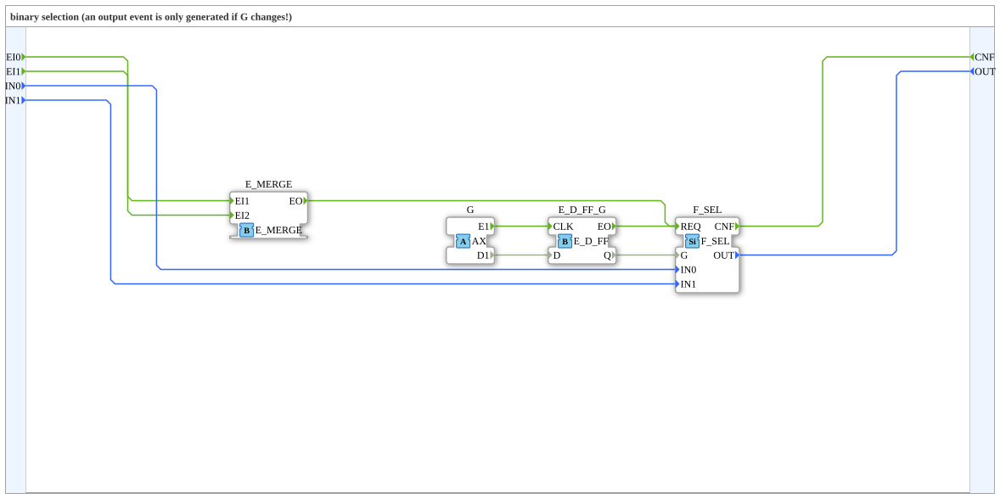

# AX_SEL

* * * * * * * * * *

## Introduction

The AX_SEL function block is a binary selector used to choose between two input values. It belongs to the category of standard selection functions according to IEC 61131-3 and enables flexible data selection based on a control signal.

## Interface Structure

### **Event Inputs**

- **EI0** - Set IN0 (data association: `IN0`)
- **EI1** - Set IN1 (data association: `IN1`)

### **Event Outputs**

- **CNF** - Confirmation of Requested Service

### **Data Inputs**

- **IN0** (ANY) - Selectable input variable
- **IN1** (ANY) - Selectable input variable

### **Data Outputs**

- **OUT** (ANY) - Selected input

### **Adapters**

- **G** (adapter::types::unidirectional::AX) - Unidirectional adapter for control

## Functionality

The AX_SEL function block selects between two input values (IN0 and IN1) and outputs the selected value at output OUT. The selection is controlled via the connected adapter G: `G.E1` clocks an internal D flip-flop (`E_D_FF_G`) that takes over `G.D1` and supplies it as selector `G` to `F_SEL`. `F_SEL` is triggered by the flip-flop event (G has changed) and directly by `EI0` and `EI1`; its `CNF` is output as the block's `CNF` and the selected value is then available at OUT. An output event is therefore generated only on an event at `G.E1`, `EI0` or `EI1`.
...

## Technical Features

- Uses the ANY data type for maximum flexibility in inputs and outputs
- Implemented as a unidirectional adapter for easy control
- Supports various data types through the use of ANY

## State Overview

The function block has a simple state:

- **Ready**: Waits for a control signal from adapter G
- Upon receiving an event (`EI0`, `EI1` or `G.E1`), the corresponding input is selected and the CNF event is triggered

## Application Scenarios

- Selection between two different sensors
- Switching between operating modes
- Selection of data sources depending on operating states
- Switching between manual and automatic control

## ⚖️ Comparison with Similar Function Blocks

Compared to other selection blocks, AX_SEL offers:

- Greater flexibility through the ANY data type
- Easy integration through the unidirectional adapter
- Standardized interface according to IEC 61131-3

Comparison with [F_SEL](../../../../StandardLibraries/iec61131-3/selection/F_SEL.md)

## Conclusion

The AX_SEL function block provides a simple and flexible solution for binary selection tasks in control systems. By using the ANY data type and standardized adapter interfaces, it enables versatile application in various automation projects.
