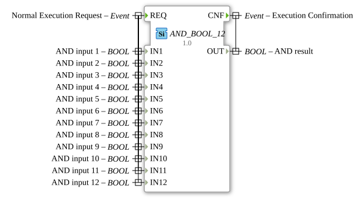

# AND_BOOL_12

* * * * * * * * * *

## Introduction

The function block `AND_BOOL_12` is a generic block for calculating the logical AND operation (classification `standard boolean function`, IEC 61131-3). It combines 12 separate BOOL inputs (`IN1` to `IN12`) and provides the result at the output `OUT`. It extends the standard AND_BOOL family (previously up to `AND_BOOL_10`) with the variant that has 12 inputs.

## Interface Structure

### **Event Inputs**

-   **REQ (Normal Execution Request):** Triggers the calculation. The event is associated with all 12 data inputs (`IN1` to `IN12`).

### **Event Outputs**

-   **CNF (Execution Confirmation):** Signals completion of the calculation. The event is associated with the data output `OUT`.

### **Data Inputs**

-   **IN1 (AND input 1):** Boolean input 1.
-   **IN2 (AND input 2):** Boolean input 2.
-   **IN3 (AND input 3):** Boolean input 3.
-   **IN4 (AND input 4):** Boolean input 4.
-   **IN5 (AND input 5):** Boolean input 5.
-   **IN6 (AND input 6):** Boolean input 6.
-   **IN7 (AND input 7):** Boolean input 7.
-   **IN8 (AND input 8):** Boolean input 8.
-   **IN9 (AND input 9):** Boolean input 9.
-   **IN10 (AND input 10):** Boolean input 10.
-   **IN11 (AND input 11):** Boolean input 11.
-   **IN12 (AND input 12):** Boolean input 12.

### **Data Outputs**

-   **OUT (AND result):** The result of the AND operation of all 12 inputs. The output is TRUE only if **all** inputs `IN1` to `IN12` are TRUE, otherwise FALSE.

### **Adapter**

This function block has no adapter interfaces.

## Operation

Upon each occurrence of the event `REQ`, all 12 inputs are read and the operation `OUT = IN1 AND IN2 AND ... AND IN12` is calculated. The result is then made available at `OUT` and `CNF` is triggered.

## Technical Features

-   **Generic block:** The type carries the attribute `GenericClassName = 'GEN_AND_BOOL'`; this instance is fixed to 12 inputs.
-   **Package:** `iec61131::booleanOperators`.
-   **Stateless:** The block is memoryless: `OUT` depends solely on the input values at the time of `REQ`.

## Application Scenarios

-   **Enable and safety interlocks:** All conditions (e.g. door contacts, emergency stop, operational readiness) must be met before an action may start.
-   **Multiple conditions:** Check whether many prerequisites are fulfilled at the same time without having to cascade several smaller AND blocks.

## ⚖️ Comparison with Similar Function Blocks

-   [`OR_BOOL_12`](./OR_BOOL_12.md): Performs the OR operation: the result is TRUE as soon as at least one input is TRUE, while `AND_BOOL_12` requires all inputs to be TRUE.
-   [`AND_BOOL_10`](./AND_BOOL_10.md): Sibling block of the family with 10 inputs.

## Conclusion

`AND_BOOL_12` is a simple, event-driven block for the AND combination of 12 Boolean signals with a fixed interface.

---

### 🌐 Related topic subpages on ms-muc-docs.de

- [🌐 Eclipse 4diac IDE & color reference on ms-muc-docs.de](https://www.ms-muc-docs.de/iec-61499/eclipse-4diac/)
