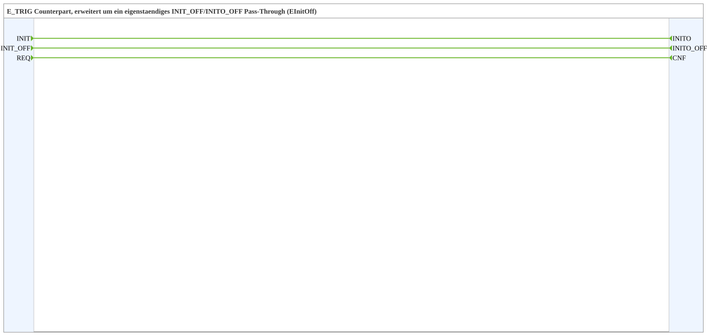

# INIT_OFF

* * * * * * * * * *

## Introduction

`INIT_OFF` is the counterpart of `E_TRIG`, extended by an independent `INIT_OFF`/`INITO_OFF` pass-through (event type `EInitOff`). The block contains no logic; every input event is forwarded directly to the corresponding output.

## Interface Structure

### **Event Inputs**

| Name | Type | Comment |
| --- | --- | --- |
| INIT | EInit | Initialization request |
| INIT_OFF | EInitOff | Initialization request, own channel independent of `INIT` |
| REQ | Event | Service request |

### **Event Outputs**

| Name | Type | Comment |
| --- | --- | --- |
| INITO | EInit | Initialization confirm |
| INITO_OFF | EInitOff | Initialization confirm, own channel independent of `INITO` |
| CNF | Event | Confirmation of requested service |

### **Data Inputs**

None.

### **Data Outputs**

None.

### **Adapters**

None.

## Functionality

The block consists of event connections only:

- `INIT` → `INITO`
- `REQ` → `CNF`
- `INIT_OFF` → `INITO_OFF`

## Technical Details

- Pure pass-through without logic and without data
- The `INIT_OFF` channel is independent of the `INIT` channel

## Application Scenarios

- Forwarding initialisation and shutdown events (`EInitOff`) in a chain of blocks

## ⚖️ Comparison with Similar Building Blocks

- [INIT](./INIT.md) only contains `INIT`/`REQ` without the `INIT_OFF` channel
- [INIT_ON_OFF](./INIT_ON_OFF.md) additionally offers an `INIT_ON`/`INITO_ON` channel

## Conclusion

`INIT_OFF` forwards `INIT`, `INIT_OFF` and `REQ` unchanged as `INITO`, `INITO_OFF` and `CNF`.
