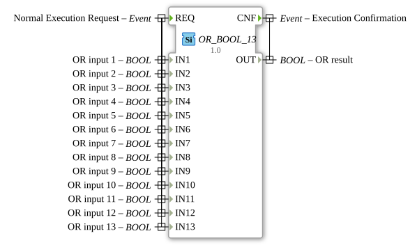

# OR_BOOL_13

* * * * * * * * * *

## Introduction

The function block `OR_BOOL_13` is a generic block for calculating the logical OR operation (classification `standard boolean function`, IEC 61131-3). It combines 13 separate BOOL inputs (`IN1` to `IN13`) and provides the result at the output `OUT`. It extends the standard OR_BOOL family (previously up to `OR_BOOL_16`) with the variant that has 13 inputs.

## Interface Structure

### **Event Inputs**

-   **REQ (Normal Execution Request):** Triggers the calculation. The event is associated with all 13 data inputs (`IN1` to `IN13`).

### **Event Outputs**

-   **CNF (Execution Confirmation):** Signals completion of the calculation. The event is associated with the data output `OUT`.

### **Data Inputs**

-   **IN1 (OR input 1):** Boolean input 1.
-   **IN2 (OR input 2):** Boolean input 2.
-   **IN3 (OR input 3):** Boolean input 3.
-   **IN4 (OR input 4):** Boolean input 4.
-   **IN5 (OR input 5):** Boolean input 5.
-   **IN6 (OR input 6):** Boolean input 6.
-   **IN7 (OR input 7):** Boolean input 7.
-   **IN8 (OR input 8):** Boolean input 8.
-   **IN9 (OR input 9):** Boolean input 9.
-   **IN10 (OR input 10):** Boolean input 10.
-   **IN11 (OR input 11):** Boolean input 11.
-   **IN12 (OR input 12):** Boolean input 12.
-   **IN13 (OR input 13):** Boolean input 13.

### **Data Outputs**

-   **OUT (OR result):** The result of the OR operation of all 13 inputs. The output is TRUE if at least one input is TRUE and FALSE only if all inputs `IN1` to `IN13` are FALSE.

### **Adapter**

This function block has no adapter interfaces.

## Operation

Upon each occurrence of the event `REQ`, all 13 inputs are read and the operation `OUT = IN1 OR IN2 OR ... OR IN13` is calculated. The result is then made available at `OUT` and `CNF` is triggered.

## Technical Features

-   **Generic block:** The type carries the attribute `GenericClassName = 'GEN_OR_BOOL'`; this instance is fixed to 13 inputs.
-   **Package:** `iec61131::booleanOperators`.
-   **Stateless:** The block is memoryless: `OUT` depends solely on the input values at the time of `REQ`.

## Application Scenarios

-   **Collective fault:** Combine several fault or warning signals into one common signal.
-   **Multiple triggers:** An action is to start as soon as at least one of many conditions or buttons is active.

## ⚖️ Comparison with Similar Function Blocks

-   [`AND_BOOL_13`](./AND_BOOL_13.md): Performs the AND operation: the result is TRUE only if all inputs are TRUE, while `OR_BOOL_13` needs just one TRUE input.
-   [`OR_BOOL_16`](./OR_BOOL_16.md): Sibling block of the family with 16 inputs.

## Conclusion

`OR_BOOL_13` is a simple, event-driven block for the OR combination of 13 Boolean signals with a fixed interface.

---

### 🌐 Related topic subpages on ms-muc-docs.de

- [🌐 Eclipse 4diac IDE & color reference on ms-muc-docs.de](https://www.ms-muc-docs.de/iec-61499/eclipse-4diac/)
