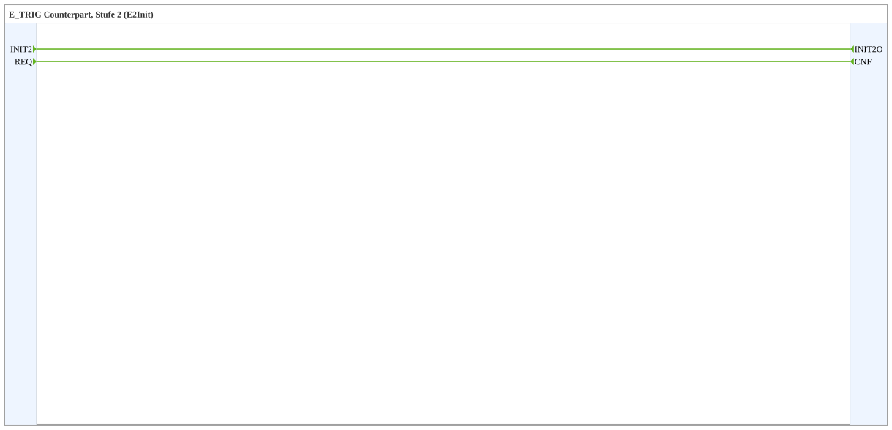

# INIT2

* * * * * * * * * *

## Introduction

`INIT2` is stage 2 of the staged initialization (library `init_stages`, package `events::init`). The function block is the counterpart to an [`E_TRIG`](../../../../StandardLibraries/events/E_TRIG.md) with the event type `E2Init`: the `E_TRIG` triggers the unconnected input `INIT2`, and `INIT2O` is connected to the `INIT` of the target. It runs after the standard `INIT` (`EInit`). The block contains no logic.

## Interface Structure

### **Event Inputs**

| Name | Type | Comment |
| ---- | ---- | ------- |
| INIT2 | E2Init | Initialization Request |
| REQ | Event | Service Request |

### **Event Outputs**

| Name | Type | Comment |
| ---- | ---- | ------- |
| INIT2O | E2Init | Initialization Confirm |
| CNF | Event | Confirmation of Requested Service |

### **Data Inputs**

None.

### **Data Outputs**

None.

### **Adapters**

None.

## Functionality

Pure event connections in the inner FB network:

- `INIT2` → `INIT2O`
- `REQ` → `CNF`

## Usage

1. Place `INIT2` directly next to the target that is to be initialized in this stage.
2. Connect `INIT2O` to the `INIT` of the target. Nothing has to be wired through the hierarchy.
3. In `EMB_RES`, add an `E_TRIG` with `EVENTTYPE` `'E2Init'` to the chain of stages (see [`init_stages`](../../index.md)).

## Technical Details

- Composite function block without data and without internal state.
- The event type `E2Init` is independent; only an `E_TRIG` with this `EVENTTYPE` triggers the input.
- A stage counts as done when all its inputs have been triggered, not when the targets have finished initializing.
- See also [`INIT`](INIT.md) (standard stage, `EInit`).

## Conclusion

`INIT2` connects initialization stage 2 to its target without wiring through the hierarchy.
