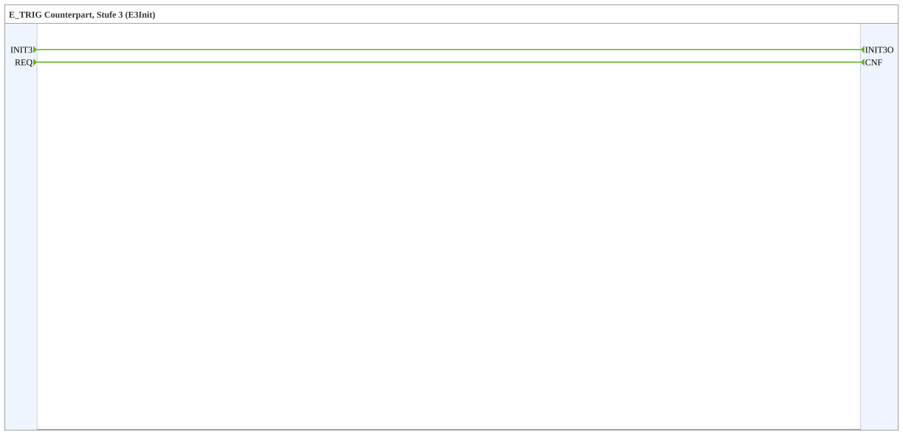

# INIT3

* * * * * * * * * *

## Introduction

`INIT3` is stage 3 of the staged initialization (library `init_stages`, package `events::init`). The function block is the counterpart to an [`E_TRIG`](../../../../StandardLibraries/events/E_TRIG.md) with the event type `E3Init`: the `E_TRIG` triggers the unconnected input `INIT3`, and `INIT3O` is connected to the `INIT` of the target. It runs after stage 2. The block contains no logic.

## Interface Structure

### **Event Inputs**

| Name | Type | Comment |
| ---- | ---- | ------- |
| INIT3 | E3Init | Initialization Request |
| REQ | Event | Service Request |

### **Event Outputs**

| Name | Type | Comment |
| ---- | ---- | ------- |
| INIT3O | E3Init | Initialization Confirm |
| CNF | Event | Confirmation of Requested Service |

### **Data Inputs**

None.

### **Data Outputs**

None.

### **Adapters**

None.

## Functionality

Pure event connections in the inner FB network:

- `INIT3` → `INIT3O`
- `REQ` → `CNF`

## Usage

1. Place `INIT3` directly next to the target that is to be initialized in this stage.
2. Connect `INIT3O` to the `INIT` of the target. In resources and SubApps, nothing has to be wired through the hierarchy (exception: composite FBs, see below).
3. In `EMB_RES`, add an `E_TRIG` with `EVENTTYPE` `'E3Init'` to the chain of stages (see [`init_stages`](../../index.md)).

## Technical Details

- Composite function block without data and without internal state.
- An `E_TRIG` with `EVENTTYPE` `'E3Init'` triggers unconnected `INIT3` inputs. A compatible event output can also trigger a connected `INIT3` input directly.
- The `E_TRIG` must be in the same resource as the target. It reaches SubApps of any depth, but not the inside of composite FBs: there, bring the `INIT3` input out at the composite interface.
- The order of the stages results from the chain of `E_TRIG` blocks: the `E_TRIG` of this stage must be at the right place in the chain, otherwise the stage runs in the wrong order (see [`init_stages`](../../index.md)).
- A stage counts as done when all its inputs have been triggered, not when the targets have finished initializing.
- See also [`INIT`](INIT.md) (standard stage, `EInit`).

## Conclusion

`INIT3` connects initialization stage 3 to its target without wiring through the hierarchy.
