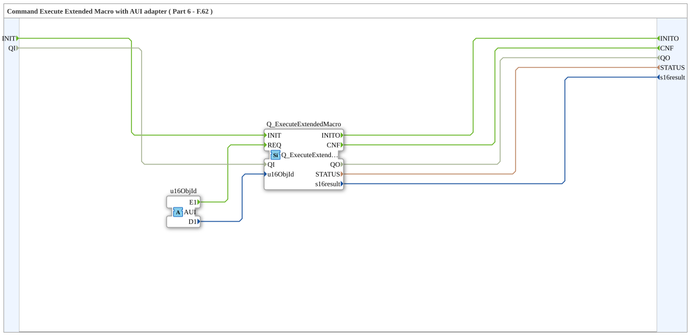

# Q_ExecuteExtendedMacro_AUI

* * * * * * * * * *

## Introduction

The **Q_ExecuteExtendedMacro_AUI** function block is an AUI adapter wrapper for **Q_ExecuteExtendedMacro** (ISO 11783‑6, Part 6 – F.62). It enables executing extended macros (16-bit macro IDs 1–999) on an ISOBUS Virtual Terminal using an AUI adapter interface.

## Interface Structure

### **Event Inputs**

| Name | Type | Comment |
|---|---|---|
| `INIT` | `EInit` | Service Initialization |

### **Event Outputs**

| Name | Type | Comment |
|---|---|---|
| `INITO` | `EInit` | Initialization Confirm |
| `CNF` | `Event` | Confirmation of Requested Service |

### **Data Inputs**

Apart from `QI`, there are no direct data inputs — extended macro Object ID is received via the AUI adapter socket.

| Name | Type   | Initial value | Comment                                |
| ---- | ------ | ------------- | -------------------------------------- |
| `QI` | `BOOL` | `TRUE`        | Quality Input - TRUE to enable service |

### **Data Outputs**

| Name | Type | Comment |
|---|---|---|
| `QO` | `BOOL` | Quality Output - TRUE if service executed successfully |
| `STATUS` | `STRING` | Service Status |
| `s16result` | `INT` | Command return code |

### **Adapters**

| Type | Name | Direction | Comment |
|---|---|---|---|
| `adapter::types::unidirectional::AUI` | `u16ObjId` | Socket (Input) | Object ID of extended macro (1–999) |

**Quality signals QI/QO:** The data input `QI` (BOOL, initial value `TRUE`) is associated with the event `INIT` and is passed through to `QI` of the internal block `Q_ExecuteExtendedMacro`. The data output `QO` (BOOL) is taken over from `Q_ExecuteExtendedMacro.QO` and is associated with the events `INITO` and `CNF`.

## Functionality

Connects internal `Q_ExecuteExtendedMacro` (*isobus::UT::Q::Q_ExecuteExtendedMacro*) to the AUI adapter interface.
An event on `u16ObjId.E1` triggers `REQ` on the inner FB, sending the 16-bit macro ID from `u16ObjId.D1` to the VT.

## Technical Features

- **16-bit Extended Macro Range:** Supports macro IDs 1 to 999 (ISO 11783-6 VT version 5+).
- **Adapter Wrapper:** Unidirectional AUI connection.

## State Overview

Delegates state handling to inner `Q_ExecuteExtendedMacro`.

## Application Scenarios

- Triggering extended macros in VT version 5+ systems via AUI adapter lines.

## Comparison with Similar Blocks

Use **Q_ExecuteMacro_AUI** for standard 8-bit macro IDs (1–255) and **Q_ExecuteExtendedMacro_AUI** for 16-bit macro IDs (1–999).

## Conclusion

**Q_ExecuteExtendedMacro_AUI** provides an adapter wrapper for extended macro execution in ISOBUS VT applications.
