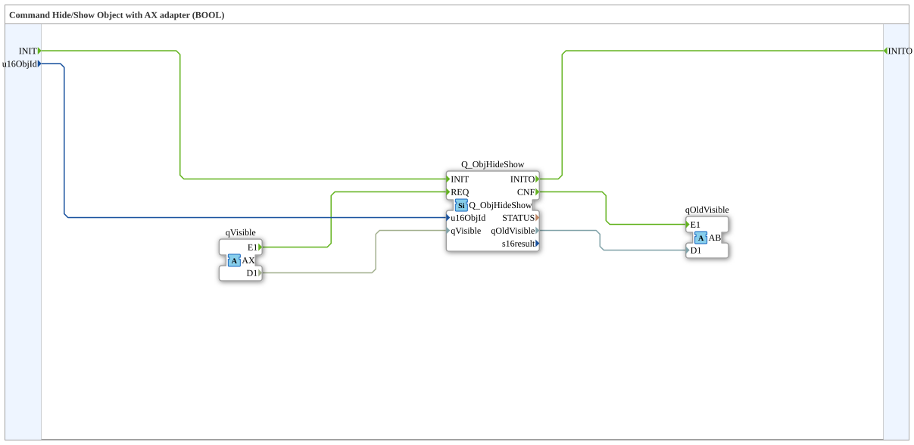

# Q_ObjHideShow_AX

* * * * * * * * * *

## Introduction

The function block **Q_ObjHideShow_AX** serves as an adapter wrapper for the existing function block `Q_ObjHideShow`. It allows the consistent hiding and showing of an object (Hide/Show) via a unidirectional AX adapter. The visibility value is passed as a Boolean state (`0` = hidden, `1` = shown).

## Interface Structure

### **Event Inputs**

| Name   | Type  | Comment                | With Variable    |
| ------ | ----- | ---------------------- | ---------------- |
| `INIT` | EInit | Service Initialization | `QI`, `u16ObjId` |

### **Event Outputs**

| Name    | Type  | Comment                     |
| ------- | ----- | --------------------------- |
| `INITO` | EInit | Initialization Confirmation |

### **Data Inputs**

| Name       | Type | Comment                                |
| ---------- | ---- | -------------------------------------- |
| `QI`       | BOOL | Quality Input - TRUE to enable service |
| `u16ObjId` | UINT | Object Identification                  |

### **Data Outputs**

Apart from `QO`, this function block does not have its own data outputs. The old visibility value is output via the plug adapter `qOldVisible`.

| Name | Type   | Comment                                                |
| ---- | ------ | ------------------------------------------------------ |
| `QO` | `BOOL` | Quality Output - TRUE if service executed successfully |

### **Adapter**

| Direction | Name          | Type                 | Comment                                                   |
| --------- | ------------- | -------------------- | --------------------------------------------------------- |
| Socket    | `qVisible`    | `unidirectional::AX` | Input of the new visibility value (0 = hidden, 1 = shown) |
| Plug      | `qOldVisible` | `unidirectional::AB` | Output of the previous visibility value (0/1/0xFF)        |

**Quality signals QI/QO:** The data input `QI` (BOOL, initial value `TRUE`) is associated with the event `INIT` and is passed through to `QI` of the internal block `Q_ObjHideShow`. The data output `QO` (BOOL) is taken over from `Q_ObjHideShow.QO` and is associated with the event `INITO`.

## Valid Object IDs

The validity rules of the internal base function block `Q_ObjHideShow` apply:

**`u16ObjId` — valid object types (Annex F.2):**
Container (3000–3999).

ID_NULL (65535) is not a valid command target but deactivates the FB when used with `INIT`.

## Functionality

1. The function block is initialized via the event `INIT`, and the object ID (`u16ObjId`) is passed to the internal function block `Q_ObjHideShow`.
2. As soon as an event arrives at socket `qVisible` (associated with the internal function block `REQ`), the new visibility value (`qVisible.D1`) is forwarded to the internal function block.
3. The internal function block performs the switchover and outputs the old value via its event `CNF`. This is reported externally via the plug `qOldVisible` (event `E1` and data `D1`).
4. The output `INITO` signals the successful completion of the initialization.

## Technical Features

- **Adapter Encapsulation:** The function block uses the standardized adapter types `AX` (for input) and `AB` (for output), allowing seamless integration into adapter-based ISOBUS networks.
- **Reuse:** The actual logic is implemented by the proven FB `Q_ObjHideShow` – the wrapper simply adds the adapter interface.
- **Boolean Control:** The visibility value is transmitted as a simple Boolean value (via the `AX` adapter), which simplifies its use in typical on/off scenarios.

## State Overview

The function block does not have an explicitly visible state machine. It undergoes an initialization step (INIT → INITO) and then reacts cyclically to incoming events at socket `qVisible` (REQ → CNF). However, the internal function block `Q_ObjHideShow` can maintain an implicit state (e.g., the currently displayed visibility).

## Application Scenarios

- Showing/hiding controls on an ISOBUS terminal.
- Controlling the display of symbols or text fields depending on user input or system states.
- A unified interface for all objects that are to be connected via adapters.

## Comparison with similar function blocks

The direct function block `Q_ObjHideShow` requires separate event and data connections for control. The wrapper function block `Q_ObjHideShow_AX` encapsulates these connections in two standardized adapters (AX/AB), thus simplifying integration into existing adapter-based architectures. Furthermore, the old visibility value is automatically provided via the plug adapter.

## Conclusion

The **Q_ObjHideShow_AX** is a practical wrapper that transfers the proven functionality of `Q_ObjHideShow` into an adapter-based interface. It enables clean, modular integration of Hide/Show commands and facilitates reuse in complex ISOBUS control systems.
