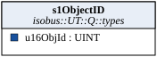

# s1ObjectID

* * * * * * * * * *

## Introduction

Description from the comment of the type: a Struct holding 1 Object ID

Package: `isobus::UT::Q::types`

## Interface structure

### **Fields**

-   **u16ObjId** (Type: `UINT`): Object ID Softkey (Default: `ID_NULL`)

Note: This page was generated from the type definition (`s1ObjectID.dtp`) and only shows the interface. A detailed description of the behavior is still missing.
