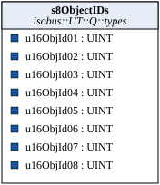

# s8ObjectIDs

* * * * * * * * * *

## Introduction

Description from the comment of the type: a Struct holding 8 Object IDs

Package: `isobus::UT::Q::types`

## Interface structure

### **Fields**

-   **u16ObjId01** (Type: `UINT`): Object ID 1 (Default: `ID_NULL`)
-   **u16ObjId02** (Type: `UINT`): Object ID 2 (Default: `ID_NULL`)
-   **u16ObjId03** (Type: `UINT`): Object ID 3 (Default: `ID_NULL`)
-   **u16ObjId04** (Type: `UINT`): Object ID 4 (Default: `ID_NULL`)
-   **u16ObjId05** (Type: `UINT`): Object ID 5 (Default: `ID_NULL`)
-   **u16ObjId06** (Type: `UINT`): Object ID 6 (Default: `ID_NULL`)
-   **u16ObjId07** (Type: `UINT`): Object ID 7 (Default: `ID_NULL`)
-   **u16ObjId08** (Type: `UINT`): Object ID 8 (Default: `ID_NULL`)

Note: This page was generated from the type definition (`s8ObjectIDs.dtp`) and only shows the interface. A detailed description of the behavior is still missing.
