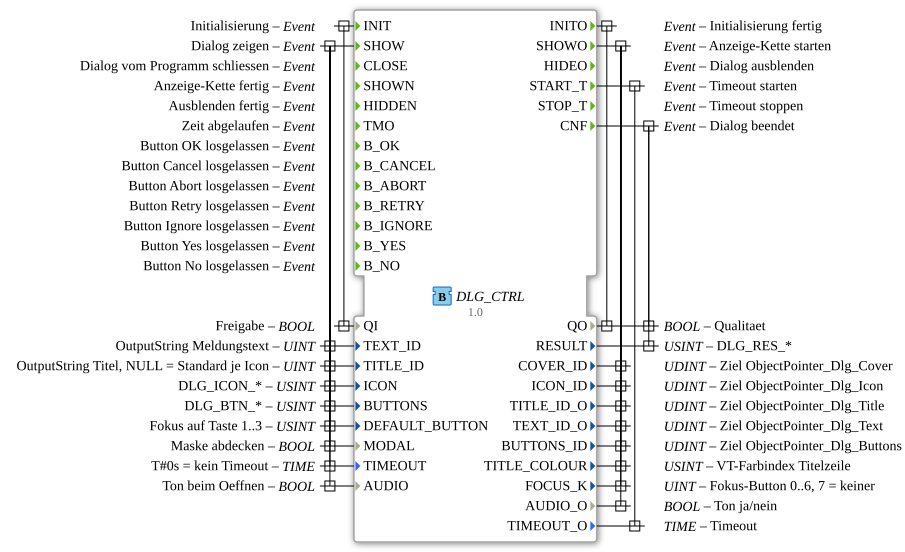

# DLG_CTRL

* * * * * * * * * *

## Introduction

Description from the comment of the type: Ablaufsteuerung eines VT-Dialogs (MessageBox)

Package: `isobus::UT::dialog`

## Interface structure

### **Event inputs**

-   **INIT** (Type: `EInit`): Initialisierung (with data: `QI`)
-   **SHOW** (Type: `Event`): Dialog zeigen (with data: `TEXT_ID`, `TITLE_ID`, `ICON`, `BUTTONS`, `DEFAULT_BUTTON`, `MODAL`, `TIMEOUT`, `AUDIO`)
-   **CLOSE** (Type: `Event`): Dialog vom Programm schliessen
-   **SHOWN** (Type: `Event`): Anzeige-Kette fertig
-   **HIDDEN** (Type: `Event`): Ausblenden fertig
-   **TMO** (Type: `Event`): Zeit abgelaufen
-   **B_OK** (Type: `Event`): Button OK losgelassen
-   **B_CANCEL** (Type: `Event`): Button Cancel losgelassen
-   **B_ABORT** (Type: `Event`): Button Abort losgelassen
-   **B_RETRY** (Type: `Event`): Button Retry losgelassen
-   **B_IGNORE** (Type: `Event`): Button Ignore losgelassen
-   **B_YES** (Type: `Event`): Button Yes losgelassen
-   **B_NO** (Type: `Event`): Button No losgelassen

### **Event outputs**

-   **INITO** (Type: `EInit`): Initialisierung fertig (with data: `QO`)
-   **SHOWO** (Type: `Event`): Anzeige-Kette starten (with data: `COVER_ID`, `ICON_ID`, `TITLE_ID_O`, `TEXT_ID_O`, `BUTTONS_ID`, `TITLE_COLOUR`, `FOCUS_K`, `AUDIO_O`)
-   **HIDEO** (Type: `Event`): Dialog ausblenden
-   **START_T** (Type: `Event`): Timeout starten (with data: `TIMEOUT_O`)
-   **STOP_T** (Type: `Event`): Timeout stoppen
-   **CNF** (Type: `Event`): Dialog beendet (with data: `QO`, `RESULT`)

### **Data inputs**

-   **QI** (Type: `BOOL`): Freigabe (Default: `TRUE`)
-   **TEXT_ID** (Type: `UINT`): OutputString Meldungstext (Default: `UINT#65535`)
-   **TITLE_ID** (Type: `UINT`): OutputString Titel, NULL = Standard je Icon (Default: `UINT#65535`)
-   **ICON** (Type: `USINT`): DLG_ICON_* (Default: `USINT#1`)
-   **BUTTONS** (Type: `USINT`): DLG_BTN_* (Default: `USINT#1`)
-   **DEFAULT_BUTTON** (Type: `USINT`): Fokus auf Taste 1..3 (Default: `USINT#1`)
-   **MODAL** (Type: `BOOL`): Maske abdecken (Default: `FALSE`)
-   **TIMEOUT** (Type: `TIME`): T#0s = kein Timeout (Default: `T#0s`)
-   **AUDIO** (Type: `BOOL`): Ton beim Oeffnen (Default: `FALSE`)

### **Data outputs**

-   **QO** (Type: `BOOL`): Qualitaet
-   **RESULT** (Type: `USINT`): DLG_RES_*
-   **COVER_ID** (Type: `UDINT`): Ziel ObjectPointer_Dlg_Cover
-   **ICON_ID** (Type: `UDINT`): Ziel ObjectPointer_Dlg_Icon
-   **TITLE_ID_O** (Type: `UDINT`): Ziel ObjectPointer_Dlg_Title
-   **TEXT_ID_O** (Type: `UDINT`): Ziel ObjectPointer_Dlg_Text
-   **BUTTONS_ID** (Type: `UDINT`): Ziel ObjectPointer_Dlg_Buttons
-   **TITLE_COLOUR** (Type: `USINT`): VT-Farbindex Titelzeile
-   **FOCUS_K** (Type: `UINT`): Fokus-Button 0..6, 7 = keiner
-   **AUDIO_O** (Type: `BOOL`): Ton ja/nein
-   **TIMEOUT_O** (Type: `TIME`): Timeout

### **Adapters (sockets)**

None.

### **Adapters (plugs)**

None.

Note: This page was generated from the type definition (`DLG_CTRL.fbt`) and only shows the interface. A detailed description of the behavior is still missing.
