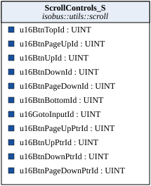

# ScrollControls_S

* * * * * * * * * *

## Introduction

Description from the comment of the type: ISOBUS UT scroll list operator controls (6 buttons + direct-position input field)

Package: `isobus::utils::scroll`

## Interface structure

### **Fields**

-   **u16BtnTopId** (Type: `UINT`): Object ID of the softkey/button that fires the TOP event (Default: `IDs::ID_NULL`)
-   **u16BtnPageUpId** (Type: `UINT`): Object ID of the softkey/button that fires the UP_UP event (Default: `IDs::ID_NULL`)
-   **u16BtnUpId** (Type: `UINT`): Object ID of the softkey/button that fires the UP event (Default: `IDs::ID_NULL`)
-   **u16BtnDownId** (Type: `UINT`): Object ID of the softkey/button that fires the DOWN event (Default: `IDs::ID_NULL`)
-   **u16BtnPageDownId** (Type: `UINT`): Object ID of the softkey/button that fires the DOWN_DOWN event (Default: `IDs::ID_NULL`)
-   **u16BtnBottomId** (Type: `UINT`): Object ID of the softkey/button that fires the BOTTOM event (Default: `IDs::ID_NULL`)
-   **u16GotoInputId** (Type: `UINT`): Object ID of the InputNumber field for direct row-position entry (drives the POS/GOTO event's SET_POS value) (Default: `IDs::ID_NULL`)
-   **u16BtnPageUpPtrId** (Type: `UINT`): Object ID of the ObjectPointer (SoftKeyMask/Container child) that currently resolves to u16BtnPageUpId - redirected to ID_NULL to hide the button when qAtFirst, restored to u16BtnPageUpId otherwise (Default: `IDs::ID_NULL`)
-   **u16BtnUpPtrId** (Type: `UINT`): Object ID of the ObjectPointer that currently resolves to u16BtnUpId - redirected to ID_NULL to hide the button when qAtFirst, restored to u16BtnUpId otherwise (Default: `IDs::ID_NULL`)
-   **u16BtnDownPtrId** (Type: `UINT`): Object ID of the ObjectPointer that currently resolves to u16BtnDownId - redirected to ID_NULL to hide the button when qAtLast, restored to u16BtnDownId otherwise (Default: `IDs::ID_NULL`)
-   **u16BtnPageDownPtrId** (Type: `UINT`): Object ID of the ObjectPointer that currently resolves to u16BtnPageDownId - redirected to ID_NULL to hide the button when qAtLast, restored to u16BtnPageDownId otherwise (Default: `IDs::ID_NULL`)

Note: This page was generated from the type definition (`ScrollControls_S.dtp`) and only shows the interface. A detailed description of the behavior is still missing.
