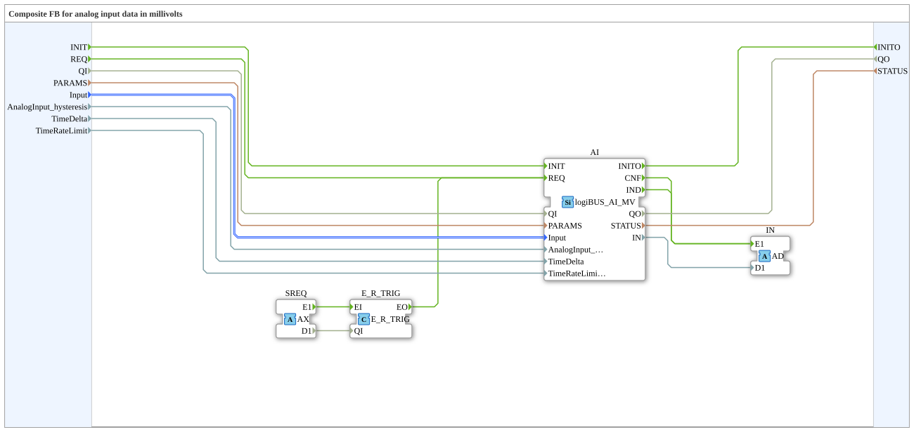

# logiBUS_AI_MVA

* * * * * * * * * *

## Introduction

`logiBUS_AI_MVA` is a composite block around [`logiBUS_AI_MV`](logiBUS_AI_MV.md) with an adapter output: `IN` (adapter `AD`) delivers the calibrated voltage at the pin in millivolts. It relates to `logiBUS_AI_MV` as [`logiBUS_AI_IDA`](logiBUS_AI_IDA.md) relates to `logiBUS_AI_ID`.

## Interface structure

### **Event inputs**

| Event | Type  | With                                                                | Description                                       |
| ----- | ----- | ------------------------------------------------------------------- | ------------------------------------------------- |
| INIT  | EInit | QI, PARAMS, Input, AnalogInput_hysteresis, TimeDelta, TimeRateLimit | Service initialization, passed straight through   |
| REQ   | Event | QI                                                                  | Immediate read                                    |

### **Event outputs**

| Event | Type  | With       | Description                 |
| ----- | ----- | ---------- | --------------------------- |
| INITO | EInit | QO, STATUS | Initialization confirmation |

### **Data inputs**

| Name                   | Type                          | Initial value | Description                                                                        |
| ---------------------- | ----------------------------- | ------------- | ---------------------------------------------------------------------------------- |
| QI                     | BOOL                          | –             | Event input qualifier                                                              |
| PARAMS                 | STRING                        | –             | Service parameters                                                                 |
| Input                  | logiBUS::io::AI::logiBUS_AI_S | Invalid       | Selects the input (I1..I8)                                                         |
| AnalogInput_hysteresis | DWORD                         | –             | IND when the voltage changes by more than this many mV (0 = off, 1 = every change) |
| TimeDelta              | DWORD                         | 250           | Cyclic IND after at most this many ms (0 or 16#FFFFFFFF = off)                     |
| TimeRateLimit          | DWORD                         | 100           | At most one IND per this many ms (less than TimeDelta)                             |

### **Data outputs**

| Name   | Type   | Description            |
| ------ | ------ | ---------------------- |
| QO     | BOOL   | Event output qualifier |
| STATUS | STRING | Service status         |

### **Adapters**

| Direction | Name | Type                               | Description                                                                                                                              |
| --------- | ---- | ---------------------------------- | ---------------------------------------------------------------------------------------------------------------------------------------- |
| Plug      | IN   | adapter::types::unidirectional::AD | Delivers the calibrated voltage at the pin in mV as an adapter event and data (`E1`/`D1`) instead of the inner block's individual `CNF`/`IND` events |
| Socket    | SREQ | adapter::types::unidirectional::AX | External service request, edge-triggered onto `AI.REQ` via `E_R_TRIG`                                                                    |

## How it works

The block wraps `logiBUS_AI_MV` (instance `AI`). The internal network connects:

- **INIT** → **AI.INIT** and **AI.INITO** → **INITO**.
- **REQ** → **AI.REQ**: immediate read.
- **SREQ.E1** → **E_R_TRIG** → **AI.REQ**: an external adapter can also trigger a read.
- **AI.IND** and **AI.CNF** → **IN.E1**, **AI.IN** → **IN.D1**: new data is present at the plug `IN`.
- QI, PARAMS, Input, AnalogInput_hysteresis, TimeDelta and TimeRateLimit go straight to the inner block, QO and STATUS come from there.

Value of `IN`, hysteresis and timing are as for [`logiBUS_AI_MV`](logiBUS_AI_MV.md): `D1` is the voltage at the pin in mV, `AnalogInput_hysteresis` is in mV.

## Technical notes

- **Calibration required:** Without a calibration for the channel, INIT returns `QO` = FALSE and `STATUS` = `ADC calibration not available`. This applies to the ESP32-S31: ESP-IDF 6.1 has no calibration for it yet. On ESP32-S3 and ESP32-P4 the block works.
- **The voltage at the terminal** depends on the voltage divider of the board and is not included.

## Comparison with similar blocks

- **[`logiBUS_AI_MV`](logiBUS_AI_MV.md):** The inner block without adapters and without the external request socket.
- **[`logiBUS_AI_IDA`](logiBUS_AI_IDA.md):** Same structure, but `IN` delivers the raw value (0-4095) instead of millivolts.
