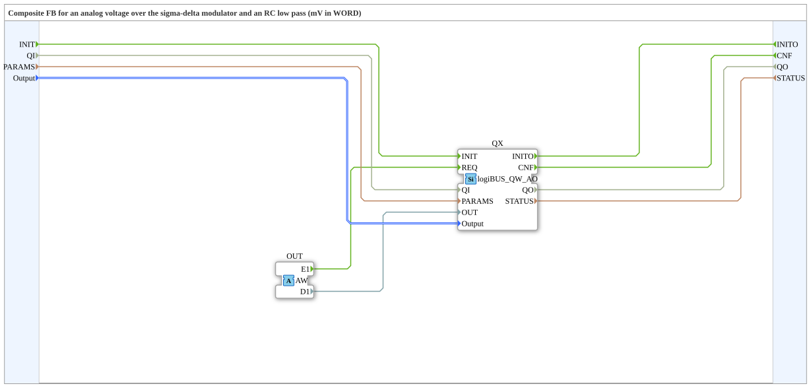

# logiBUS_QWA_AO

* * * * * * * * * *

## Introduction

The function block `logiBUS_QWA_AO` is a composite around `logiBUS_QW_AO`. It receives the voltage in mV through an adapter (socket `OUT`, type `AW`, in `D1`).

**Requirement:** an RC filter must be present on the board or on an add-on board. The block is not meant for the power outputs. The cutoff frequency of the filter must be well below the pulse frequency of 10 MHz. Ripple and settling time depend on the cutoff frequency and the load; the block gives no requirements for this, the dimensioning is part of the board.

## Interface Structure

### **Event Inputs**

| Event | Type | Linked to / Comment |
|---|---|---|
| INIT | EInit | Service initialization; linked to QI, PARAMS, Output |
| *no further event input* | | *New values arrive through the adapter* |

### **Event Outputs**

| Event | Type | Linked to / Comment |
|---|---|---|
| INITO | EInit | Initialization acknowledgement; linked to QO, STATUS |
| CNF | Event | Acknowledgement of the requested service operation; linked to QO, STATUS |

### **Data Inputs**

| Variable | Type | Comment |
|---|---|---|
| QI | BOOL | Event input qualifier |
| PARAMS | STRING | Service parameters |
| Output | logiBUS::io::DQ::logiBUS_DO_S | Identifies the output Output_Q1..Q8; initial value `logiBUS_DO::Invalid` |

### **Data Outputs**

| Variable | Type | Comment |
|---|---|---|
| QO | BOOL | Event output qualifier |
| STATUS | STRING | Service status |

### **Adapters**

| Type | Name | Direction | Comment |
|---|---|---|---|
| adapter::types::unidirectional::AW | OUT | Socket | Receives the event (E1) and the voltage in mV (D1) |

## Functionality

The composite forwards `INIT` with `QI`, `PARAMS` and `Output` to the internal `logiBUS_QW_AO` (`QX`). Event `E1` and value `D1` of the adapter `OUT` go to `QX` as `REQ` and `OUT`; `CNF` of `QX` is passed outward.

## Technical Features

- Resolution 256 steps, about 13 mV; range 0..3287 mV.
- VDD_IO is taken as 3300 mV, not measured.
- The real voltage depends on the RC filter and the load.
- Source: comments in the `.fbt` of `logiBUS_io-3.3.0`; the firmware behavior is described there and was not verified on hardware here.

## Comparison

| Block | Difference |
|---|---|
| `logiBUS_QD_SDM` | same pulse density, but value 0..8191 and 1 MHz; no voltage value in mV |

## Application Scenarios

- Simple analog output (setpoint, auxiliary voltage) with an RC filter at the logic output.
- Voltage setpoints in mV for downstream electronics.
