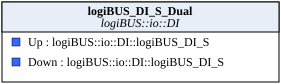

# logiBUS_DI_S_Dual

* * * * * * * * * *

## Introduction

Description from the comment of the type: logiBUS DI Struct Dual

Package: `logiBUS::io::DI`

## Interface structure

### **Fields**

-   **Up** (Type: `logiBUS::io::DI::logiBUS_DI_S`): forward, up, right, clockwise (Default: `(Pin := 255)`)
-   **Down** (Type: `logiBUS::io::DI::logiBUS_DI_S`): backward, down, left, counter-clockwise (Default: `(Pin := 255)`)

Note: This page was generated from the type definition (`logiBUS_DI_S_Dual.dtp`) and only shows the interface. A detailed description of the behavior is still missing.
