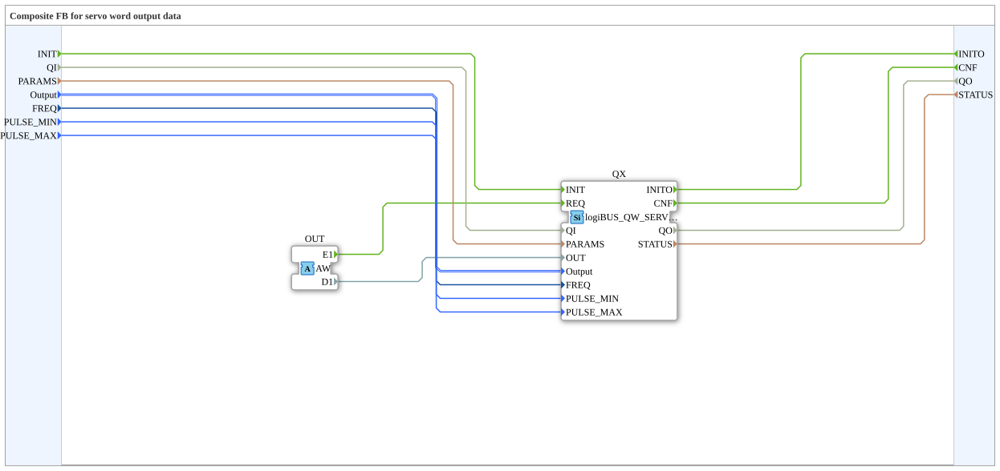

# logiBUS_QWA_SERVO

* * * * * * * * * *

## Introduction

The function block `logiBUS_QWA_SERVO` is a composite around `logiBUS_QW_SERVO`. It receives the position through an adapter (socket `OUT`, type `AW`, in `D1`) and passes `FREQ`, `PULSE_MIN` and `PULSE_MAX` on at INIT.

**Signal level:** the servo needs a logic level signal. On boards with a power stage, take the signal before the power stage.

## Interface Structure

### **Event Inputs**

| Event | Type | Linked to / Comment |
|---|---|---|
| INIT | EInit | Service initialization; linked to QI, PARAMS, Output, FREQ, PULSE_MIN, PULSE_MAX |
| *no further event input* | | *New values arrive through the adapter* |

### **Event Outputs**

| Event | Type | Linked to / Comment |
|---|---|---|
| INITO | EInit | Initialization acknowledgement; linked to QO, STATUS |
| CNF | Event | Acknowledgement of the requested service operation; linked to QO, STATUS |

### **Data Inputs**

| Variable | Type | Comment |
|---|---|---|
| QI | BOOL | Event input qualifier |
| PARAMS | STRING | Service parameters |
| Output | logiBUS::io::DQ::logiBUS_DO_S | Identifies the output Output_Q1..Q8; initial value `logiBUS_DO::Invalid` |
| FREQ | UDINT | Repetition rate of the servo pulse in Hz, read at INIT; initial value `50` (one pulse every 20 ms). Servos with the same `FREQ` share an MCPWM timer. |
| PULSE_MIN | TIME | Pulse width for `OUT` = 0, read at INIT (resolution 1 µs); initial value `T#1000us`. If `PULSE_MAX` is below `PULSE_MIN`, the direction is reversed. |
| PULSE_MAX | TIME | Pulse width for `OUT` = `0xFAFF` (100 %), read at INIT (resolution 1 µs); initial value `T#2000us`. |

### **Data Outputs**

| Variable | Type | Comment |
|---|---|---|
| QO | BOOL | Event output qualifier |
| STATUS | STRING | Service status |

### **Adapters**

| Type | Name | Direction | Comment |
|---|---|---|---|
| adapter::types::unidirectional::AW | OUT | Socket | Receives the event (E1) and the position 0..0xFAFF (D1) |

## Functionality

The composite forwards `INIT` with `QI`, `PARAMS`, `Output`, `FREQ`, `PULSE_MIN` and `PULSE_MAX` to the internal `logiBUS_QW_SERVO` (`QX`). Event `E1` and value `D1` of the adapter `OUT` go to `QX` as `REQ` and `OUT`; `CNF` of `QX` is passed outward.

## Change compared to version 3.2.0

Up to `logiBUS_io` 3.2.0 the servo ran on the LEDC, fixed at 250 Hz and 800 to 2180 µs. Since 3.3.0 it runs on the MCPWM with the parameters `FREQ`, `PULSE_MIN` and `PULSE_MAX` and the initial values 50 Hz and 1000 to 2000 µs (`logiBUS_QW_SERVO` version 1.2, `logiBUS_QWA_SERVO` version 1.1).

!!! warning "Existing applications"
    Applications built on the old fixed values drive a smaller travel with the new initial values. With a 9 g servo it was only about ±35° instead of about ±80° before. Suitable values for `FREQ`, `PULSE_MIN` and `PULSE_MAX` are in the table below and at the respective servo.

## Values for common servos

| Servo | `FREQ` | `PULSE_MIN` | `PULSE_MAX` | Note |
|---|---|---|---|---|
| Initial values of the block | 50 | `T#1000us` | `T#2000us` | measured with an oscilloscope (Franz, 2026-11-06): 50 Hz, 0 % = 1.0 ms, 50 % = 1.5 ms, 100 % = 2.0 ms |
| 9 g servo, 180° ([hardware page](https://meisterschulen-am-ostbahnhof-munchen-docs.readthedocs.io/projects/visual-programming-languages-docs/en/latest/hw/logiBUS/Servos/)) | 50 | `T#500us` | `T#2500us` | manufacturer data 0.5 to 2.5 ms for 0 to 180°; travels 90° in each direction with it (tested) |
| Blue Bird BMS-L530MG (car servo) | 250 | `T#1100us` | `T#1900us` | example from the comment of the block |
| Values up to 3.2.0 | 250 | `T#800us` | `T#2180us` | fixed in the driver, no longer the initial value |

## Operating notes

- If a servo drives against the mechanical stop with too large a range, it hums and gets warm. Then reduce `PULSE_MIN` and `PULSE_MAX` symmetrically around 1.5 ms.
- Supply the servo from a source of its own, not from the 3.3 V regulator of the ESP, with a common ground (details on the [hardware page](https://meisterschulen-am-ostbahnhof-munchen-docs.readthedocs.io/projects/visual-programming-languages-docs/en/latest/hw/logiBUS/Servos/)).

## Technical Features

- Runs on the MCPWM; servos with the same `FREQ` share a timer.
- `FREQ`, `PULSE_MIN` and `PULSE_MAX` are read at `INIT` only.
- Pulse width resolution 1 µs.
- `OUT` is `WORD` (0..`0xFAFF`), not the full 16-bit range.
- Source: comments in the `.fbt` of `logiBUS_io-3.3.0`; the firmware behavior is described there and was not verified on hardware here.

## Comparison

| Block | Difference |
|---|---|
| `logiBUS_QD_PWM` | PWM output with 13 bit and ramp; no servo pulse with a fixed time window |

## Application Scenarios

- Servo control (model servo, flap, valve position) from the 4diac application.
- Car servos at 250 Hz through suitable values for `FREQ`, `PULSE_MIN` and `PULSE_MAX`.
