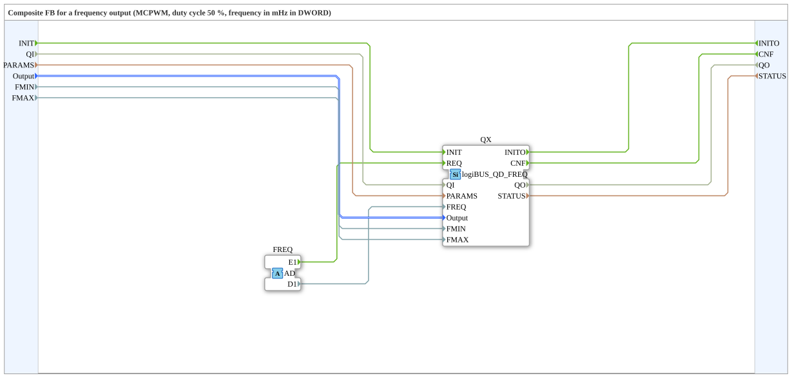

# logiBUS_QDA_FREQ

* * * * * * * * * *

## Introduction

The function block `logiBUS_QDA_FREQ` is a composite around `logiBUS_QD_FREQ`. It receives the frequency through an adapter (socket `FREQ`, type `AD`) and can therefore be connected to other blocks without event wiring of its own. Output: square wave with a fixed duty cycle of 50 %, frequency in millihertz (`1000` = 1 Hz).

## Interface Structure

### **Event Inputs**

| Event | Type | Linked to / Comment |
|---|---|---|
| INIT | EInit | Service initialization; linked to QI, PARAMS, Output, FMIN, FMAX |
| *no further event input* | | *New frequencies arrive through the adapter* |

### **Event Outputs**

| Event | Type | Linked to / Comment |
|---|---|---|
| INITO | EInit | Initialization acknowledgement; linked to QO, STATUS |
| CNF | Event | Acknowledgement of the requested service operation; linked to QO, STATUS |

### **Data Inputs**

| Variable | Type | Comment |
|---|---|---|
| QI | BOOL | Event input qualifier |
| PARAMS | STRING | Service parameters |
| Output | logiBUS::io::DQ::logiBUS_DO_S | Identifies the output Output_Q1..Q8; initial value `logiBUS_DO::Invalid` |
| FMIN | DWORD | Lowest frequency in mHz, read at INIT; initial value `10000` (10 Hz). Sets the timer resolution. |
| FMAX | DWORD | Highest frequency in mHz, read at INIT; initial value `10000000` (10 kHz). Higher `FREQ` values are limited. |

### **Data Outputs**

| Variable | Type | Comment |
|---|---|---|
| QO | BOOL | Event output qualifier |
| STATUS | STRING | Service status |

### **Adapters**

| Type | Name | Direction | Comment |
|---|---|---|---|
| adapter::types::unidirectional::AD | FREQ | Socket | Receives the event (E1) and the frequency in mHz (D1); `0` = off |

## Functionality

The composite forwards `INIT` with `QI`, `PARAMS`, `Output`, `FMIN` and `FMAX` to the internal `logiBUS_QD_FREQ` (`QX`). The event `E1` and the value `D1` of the adapter `FREQ` go to `QX` as `REQ` and `FREQ`. `CNF` of `QX` is passed outward. Like all composite inputs, `FMIN` and `FMAX` are taken over at `INIT` only.

## Resolution, `FMIN` and `FMAX`

The frequency output runs on the MCPWM with a timer of its own per output and does not use an LEDC timer (source: `PWM_KONZEPT.md`). The timer is 16 bit wide. `FMIN` sets its resolution, roughly `FMIN` · 65536. The higher `FREQ` is above `FMIN`, the coarser the steps: the step size is about `FREQ`² / resolution. With the initial value `FMIN` = 10 Hz, the comment of the block gives as an example a resolution of 640 kHz, a step of 1.6 Hz at 1 kHz and 156 Hz at 10 kHz.

`FMAX` limits the frequency upward, but never beyond what the chip can produce with the resolution from `FMIN` (half the resolution). Frequencies outside `FMIN` to `FMAX` are limited, and `STATUS` says so.

## Power stages

The firmware does not check the frequency against the power stage behind the output. Limits and turn-off energy are on the hardware page [Power stages of the outputs](https://meisterschulen-am-ostbahnhof-munchen-docs.readthedocs.io/projects/visual-programming-languages-docs/en/latest/hw/logiBUS/Leistungsstufen/).

## Technical Features

- Duty cycle fixed at 50 %, no input for it.
- Frequency in mHz as `DWORD` (range of DDI 583: `0` to `2147483647`).
- According to the concept, `QI = FALSE` sets the output to 0 or low.
- Source: comments in the `.fbt` and `PWM_KONZEPT.md`; the firmware behavior is described there and was not verified here.

## Comparison

| Block | Difference |
|---|---|
| `logiBUS_QD_PWM` | fixed frequency (at INIT), variable duty cycle |
| `logiBUS_QDA_FREQ` | variable frequency, fixed duty cycle 50 % |
