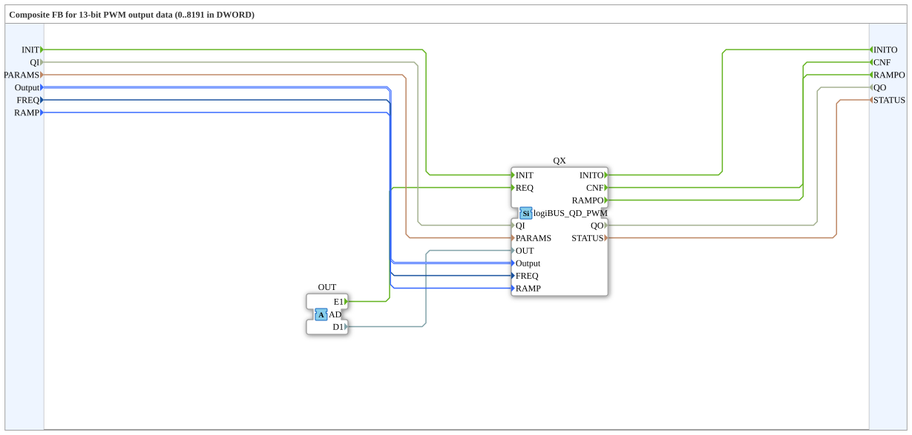

# logiBUS_QDA_PWM

* * * * * * * * * *

## Introduction

The **logiBUS_QDA_PWM** function block is a composite block for controlling a PWM (Double Word) output via a logiBUS system. It encapsulates the initialization and triggering of an internal PWM output block and provides an adapter interface for receiving commands (events and data) from external sources. The block was developed for use in agricultural technology and is licensed under EPL 2.0.

## Interface Structure

### **Event Inputs**

| Event                    | Type  | Comment                                    |
| ------------------------ | ----- | ------------------------------------------ |
| INIT                     | EInit | Service Initialization                     |
| *no further event input* |       | *All triggers are handled via the adapter* |

### **Event Outputs**

| Event | Type  | Comment                                |
| ----- | ----- | -------------------------------------- |
| INITO | EInit | Initialization Acknowledgement         |
| CNF   | Event | Acknowledgement of a requested service |
| RAMPO | Event | Ramp finished, value reached (with `QO`) |

### **Data Inputs**

| Variable | Type                          | Comment                                                               |
| -------- | ----------------------------- | --------------------------------------------------------------------- |
| QI       | BOOL                          | Input Qualifier (Enable Initialization)                               |
| PARAMS   | STRING                        | Service Parameter (e.g., Addressing, Configuration)                   |
| Output   | logiBUS::io::DQ::logiBUS_DO_S | Output Identification (e.g., Output_Q1..Q8); Initial Value: *Invalid* |
| FREQ     | UDINT                         | PWM frequency in Hz, read at INIT; initial value `400`                |
| RAMP     | TIME                          | Ramp time to the new value, read at INIT; initial value `T#0ms` (jump) |

### **Data Outputs**

| Variable | Type   | Comment                                  |
| -------- | ------ | ---------------------------------------- |
| QO       | BOOL   | Output Qualifier (Initialization Status) |
| STATUS   | STRING | Service Status (Failure/Success Message) |

### **Adapters**

| Type                               | Name | Direction | Comment                                                            |
| ---------------------------------- | ---- | --------- | ------------------------------------------------------------------ |
| adapter::types::unidirectional::AD | OUT  | Socket    | Receives trigger event (E1) and output data (D1) from the resource |

## Functionality

The function block is implemented as a composite and contains an internal instance of the function block `logiBUS::io::DQ::logiBUS_QD_PWM` (referred to here as *QX*). The logic can be described as follows:

1. **Initialization:**

An INIT event at the input triggers the initialization of the internal function block. The data inputs *QI*, *PARAMS*, *Output*, *FREQ*, and *RAMP* are then forwarded to the internal function block. After successful initialization, the event *INITO* is output, along with the output data *QO* and *STATUS*.

1. **Triggering via Adapter:**

The adapter *OUT* receives an external event *E1* and a data value *D1*. The event is forwarded to the internal function block as a *REQ* (Request), and the data *D1* as an *OUT* value. The internal function block processes this request and acknowledges it with the event *CNF*, which is then output to the external system via the *CNF* output. The associated output data *QO* and *STATUS* are updated.

This function block allows for a clean separation of initialization and cyclic output: Configuration is performed once via INIT, while the actual PWM output is triggered by the adapter.

## Frequency and ramp (from version 1.2)

- **`FREQ`** (UDINT, in Hz, default `400`): PWM frequency, read at `INIT` only. A new frequency needs a new `INIT`. Outputs with the same frequency share one LEDC timer. There are 4 timers, and LED blinking also uses one.
- **`RAMP`** (TIME, default `T#0ms`): transition time to the new value as a hardware ramp, does not block. `T#0ms` is a jump. In the composite, `RAMP` is taken over at `INIT` only; the ramp time then applies to every new value that arrives through the adapter.
- **`RAMPO`** (event output, with `QO`): the value is reached. This is the end of the ramp, directly after the jump with `T#0ms`. No `RAMPO` follows `INIT`.
- The duty cycle stays `0` to `8191` (13 bit).
- Source of these statements: comments in the block description (`.fbt`) and `PWM_KONZEPT.md`; the firmware behavior is described there and was not verified here.

### Notes on the power stages

The firmware does not check the frequency against the power stage of the board. The following limits are only a hint (source: the comment of `FREQ` in the block and `PWM_KONZEPT.md`):

| Power stage | Hint |
|---|---|
| APIXON 15 PWR Q1 (BTH50030) | at most 100 Hz |
| BTS7030, BTT6030, BTH6070 | for valves 100 to 200 Hz |
| Trainer20 | without power stage |

Which board carries which power stage is not yet decided and is not documented here.

## Changes compared to version 1.1

- **New:** inputs `FREQ` and `RAMP`, event `RAMPO`.
- **Behavior change:** the default of `RAMP` is `T#0ms` (jump). Until now every new value was applied as a fixed 500 ms ramp. Existing programs therefore now jump to the new value. To keep the soft start, set `RAMP = T#500ms`.
- **Requirement:** The ELF `logiBUS_io-3.1.0` (`-xtensa.elf` for S3, `-riscv32.elf` for P4/S31) needs firmware with the new host symbols `elf_isr_ledc_fade_end`, `ledc_cb_register`, `ledc_fade_stop`, `ledc_get_duty`, `ledc_timer_pause`, `lroundf` and `powf`; on P4/S31 additionally `ledc_fill_multi_fade_param_list` and `ledc_set_multi_fade` (host tables: LOGIBUS `3142a703`). On older firmware the ELF does not load; loading aborts because of the missing symbol. `FORTE_ABI` stays `6`, so the difference cannot be seen from it. Always deliver firmware and ELF together. (Statement from development, not verified against the firmware.)
- **Status:** not yet tested on hardware.

## Technical Features

- **Composite Function Block:** The function block encapsulates all the logic of a PWM output function block and provides a standardized adapter interface for data exchange with the resource.
- **13-Bit PWM Output (`0`–`8191`):** The adapter data element *D1* (`DWORD`) expects a 13-bit raw PWM value (`0` = 0% duty cycle, `8191` = 100% duty cycle, $2^{13} = 8192$ states).
- **Initialization Parameters:** Flexible configuration data, necessary for addressing or parameterizing the logiBUS module, can be passed via *PARAMS* (STRING).
- **Error Handling:** The *STATUS* output provides a textual description of the service status (e.g., error messages for invalid configurations).

## State Overview

Since this is a composite function block without its own state machine, the state is defined by the internal function block *logiBUS_QD_PWM*. Typical states are:

- **IDLE:** Waiting for initialization or a trigger.
- **INITIALIZING:** During initialization (INIT received, INITO not yet sent).
- **OPERATIONAL:** Ready for cyclic triggers (via adapter).
- **ERROR:** Error state, indicated by *QO = FALSE* or *STATUS* with an error message.

The internal function block switches between these states depending on the events and data.

## Application Scenarios

- **Agricultural Machinery:** Control of PWM-driven actuators (e.g., hydraulic valves, engine speed) via a logiBUS network.
- **Automation Systems:** Output of pulse-width modulated signals with 13-bit resolution (`0`–`8191`), controlled by a higher-level controller.
- **Remote Maintenance and Configuration:** The adapter allows new PWM values to be sent from a higher-level resource (e.g., HMI or PLC) without repeating the initialization process.

## Comparison with Similar Function Blocks

| Function Block      | Type            | Special Feature                                                                   |
| ------------------- | --------------- | --------------------------------------------------------------------------------- |
| logiBUS_QD_PWM      | Composite/Basic | Directly controllable via INIT, REQ, CNF; without an adapter interface.           |
| **logiBUS_QDA_PWM** | Composite       | Like logiBUS_QD_PWM, but with an adapter for external triggering and data supply. |
| logiBUS_DO (simple) | Basic           | Simple digital output, no PWM function.                                           |

The function block described here offers greater flexibility, as the actual output via the adapter can occur asynchronously from initialization. A disadvantage is the dependence on the correct provision of the adapter signals.

## Conclusion

The **logiBUS_QDA_PWM** function block is a practical encapsulation of a PWM output for logiBUS. By combining INIT-based configuration and adapter-based triggering, it is particularly suitable for applications requiring one-time parameterization followed by cyclic or event-driven output. The use of standardized types and the clear separation of interfaces facilitate integration into IEC 61499-based control systems.

---

### 🌐 Related topic subpages on ms-muc-docs.de

- [🌐 The PWM signal & infographic on ms-muc-docs.de](https://www.ms-muc-docs.de/automatisierung/das-pwm-signal-die-kunst-spannung-zu-zerhacken/das-pwm-signal-die-kunst-spannung-zu-zerhacken-website/)
