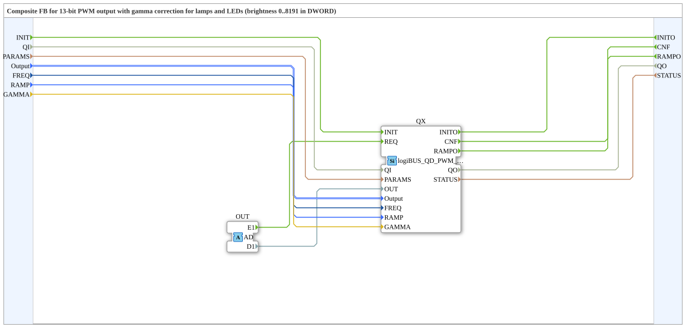

# logiBUS_QDA_PWM_G

* * * * * * * * * *

## Introduction

The function block `logiBUS_QDA_PWM_G` is the gamma variant of `logiBUS_QDA_PWM`: it outputs a PWM value with gamma correction for LEDs and lamps. `OUT` is the brightness as the eye sees it (`0` to `8191`). The duty cycle is calculated from it. The block is a composite with an adapter interface and contains `logiBUS_QD_PWM_G` internally.

## Interface Structure

### **Event Inputs**

| Event | Type | Linked to / Comment |
|---|---|---|
| INIT | EInit | Service initialization; linked to QI, PARAMS, Output, FREQ, RAMP, GAMMA |
| *no further event input* | | *All triggers are handled via the adapter* |

### **Event Outputs**

| Event | Type | Linked to / Comment |
|---|---|---|
| INITO | EInit | Initialization acknowledgement; linked to QO, STATUS |
| CNF | Event | Acknowledgement of the requested service operation; linked to QO, STATUS |
| RAMPO | Event | Ramp finished, value reached (directly after the jump with `RAMP = T#0ms`, not after INIT); linked to QO |

### **Data Inputs**

| Variable | Type | Comment |
|---|---|---|
| QI | BOOL | Event input qualifier |
| PARAMS | STRING | Service parameters |
| Output | logiBUS::io::DQ::logiBUS_DO_S | Identifies the output Output_Q1..Q8; initial value `logiBUS_DO::Invalid` |
| FREQ | UDINT | PWM frequency in Hz, read at INIT; initial value `400` |
| RAMP | TIME | Transition time to the new value, read at INIT; initial value `T#0ms` (jump) |
| GAMMA | REAL | Exponent of the brightness curve, read at INIT; initial value `2.2` |

### **Data Outputs**

| Variable | Type | Comment |
|---|---|---|
| QO | BOOL | Event output qualifier |
| STATUS | STRING | Service status |

### **Adapters**

| Type | Name | Direction | Comment |
|---|---|---|---|
| adapter::types::unidirectional::AD | OUT | Socket | Receives the trigger event (E1) and the brightness (D1) from the resource |

## Functionality

The composite forwards `INIT` with `QI`, `PARAMS`, `Output`, `FREQ`, `RAMP` and `GAMMA` to the internal `logiBUS_QD_PWM_G` (`QX`). The event `E1` and the value `D1` of the adapter `OUT` go to `QX` as `REQ` and `OUT`. `CNF` and `RAMPO` of `QX` are passed outward. Like all composite inputs, `RAMP` and `GAMMA` are taken over at `INIT` only.

## Gamma: Options

ESP-IDF does not fix a gamma value; any formula is possible. This block calculates `pow()` with the exponent `GAMMA`:

duty cycle = 8191 · (`OUT` / 8191)^`GAMMA`

The duty cycle is rounded to integers. The values in the table were calculated, not measured on hardware; the rounding in the firmware may differ by one step.

| `GAMMA` | Meaning |
|---|---|
| 1.0 | no correction, like the block without `_G` |
| 2.2 | sRGB standard, initial value |
| 2.6, 2.8 | values from the Espressif examples, more even on many LEDs |
| others | for lamps or loads with their own characteristic; best tried out on an LED |

**Invalid `GAMMA` values:** values less than or equal to `0`, `NaN` and non-finite values run linearly like `GAMMA = 1.0`. There is no error, no `STATUS` message and no lock; the firmware allows everything. (Statement from development, part of the comment of `GAMMA` in the block from the state `f71f3fd3d` on; not contained in the source used here and not verified.)

Example for some brightness values (rounded duty cycle):

| OUT | GAMMA 1.0 | GAMMA 2.2 | GAMMA 2.6 | GAMMA 2.8 |
|---|---|---|---|---|
| 512 | 512 | 18 | 6 | 3 |
| 1024 | 1024 | 84 | 37 | 24 |
| 2048 | 2048 | 388 | 223 | 169 |
| 4096 | 4096 | 1783 | 1351 | 1177 |
| 6144 | 6144 | 4351 | 3878 | 3661 |

## When to use `_G` and when not

- **`_G` for LEDs and lamps:** with a linear duty cycle, dimming looks too fast at the bottom and too slow at the top.
- **Without `_G` for valves, motors and heaters:** there the duty cycle acts linearly, a gamma curve would be wrong.
- Whether a load gets gamma is decided solely by the choice of the block.

## Technical Features

- Same interface as `logiBUS_QDA_PWM` plus the input `GAMMA`.
- The duty cycle stays `0` to `8191` (13 bit).
- Frequency and ramp as for `logiBUS_QDA_PWM`, see there.
- Outputs with the same frequency share one LEDC timer (4 timers, LED blinking uses one).
- Source: comments in the `.fbt` and `PWM_KONZEPT.md`; the firmware behavior is described there and was not verified here.

## Comparison

| Block | Difference |
|---|---|
| `logiBUS_QDA_PWM` | linear: duty cycle = `OUT`; for valves, motors, heaters |
| `logiBUS_QDA_PWM_G` | gamma: `OUT` is the brightness; for LEDs and lamps |

## Requirements and status

- **Requirement:** The ELF `logiBUS_io-3.1.0` (`-xtensa.elf` for S3, `-riscv32.elf` for P4/S31) needs firmware with the new host symbols `elf_isr_ledc_fade_end`, `ledc_cb_register`, `ledc_fade_stop`, `ledc_get_duty`, `ledc_timer_pause`, `lroundf` and `powf`; on P4/S31 additionally `ledc_fill_multi_fade_param_list` and `ledc_set_multi_fade` (host tables: LOGIBUS `3142a703`). On older firmware the ELF does not load; loading aborts because of the missing symbol. `FORTE_ABI` stays `6`, so the difference cannot be seen from it. Always deliver firmware and ELF together. (Statement from development, not verified against the firmware.)
- Not yet tested on hardware.

### Notes on the power stages

The firmware does not check the frequency against the power stage of the board. The following limits are only a hint (source: the comment of `FREQ` in the block and `PWM_KONZEPT.md`):

| Power stage | Hint |
|---|---|
| APIXON 15 PWR Q1 (BTH50030) | at most 100 Hz |
| BTS7030, BTT6030, BTH6070 | for valves 100 to 200 Hz |
| Trainer20 | without power stage |

Which board carries which power stage is not yet decided and is not documented here.

## See also

- [logiBUS_QDA_PWM](logiBUS_QDA_PWM.md) (without gamma, with notes on frequency, ramp and power stages)
