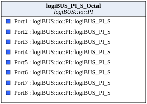

# logiBUS_PI_S_Octal

* * * * * * * * * *

## Introduction

Description from the comment of the type: logiBUS PI Struct Octal

Package: `logiBUS::io::PI`

## Interface structure

### **Fields**

-   **Port1** (Type: `logiBUS::io::PI::logiBUS_PI_S`) (Default: `(Pin := 255)`)
-   **Port2** (Type: `logiBUS::io::PI::logiBUS_PI_S`) (Default: `(Pin := 255)`)
-   **Port3** (Type: `logiBUS::io::PI::logiBUS_PI_S`) (Default: `(Pin := 255)`)
-   **Port4** (Type: `logiBUS::io::PI::logiBUS_PI_S`) (Default: `(Pin := 255)`)
-   **Port5** (Type: `logiBUS::io::PI::logiBUS_PI_S`) (Default: `(Pin := 255)`)
-   **Port6** (Type: `logiBUS::io::PI::logiBUS_PI_S`) (Default: `(Pin := 255)`)
-   **Port7** (Type: `logiBUS::io::PI::logiBUS_PI_S`) (Default: `(Pin := 255)`)
-   **Port8** (Type: `logiBUS::io::PI::logiBUS_PI_S`) (Default: `(Pin := 255)`)

Note: This page was generated from the type definition (`logiBUS_PI_S_Octal.dtp`) and only shows the interface. A detailed description of the behavior is still missing.
