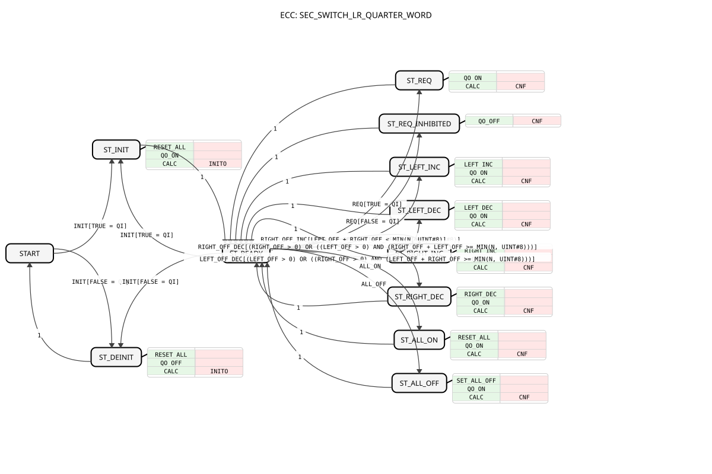
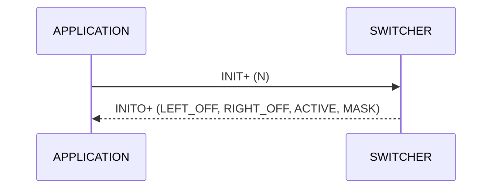
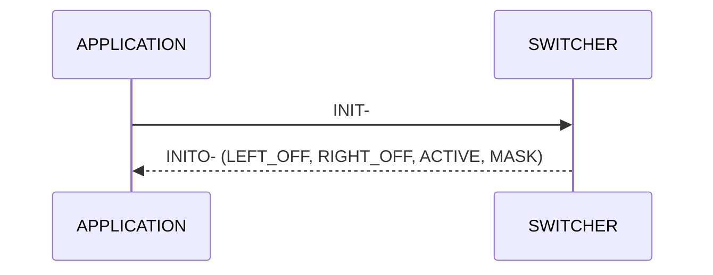
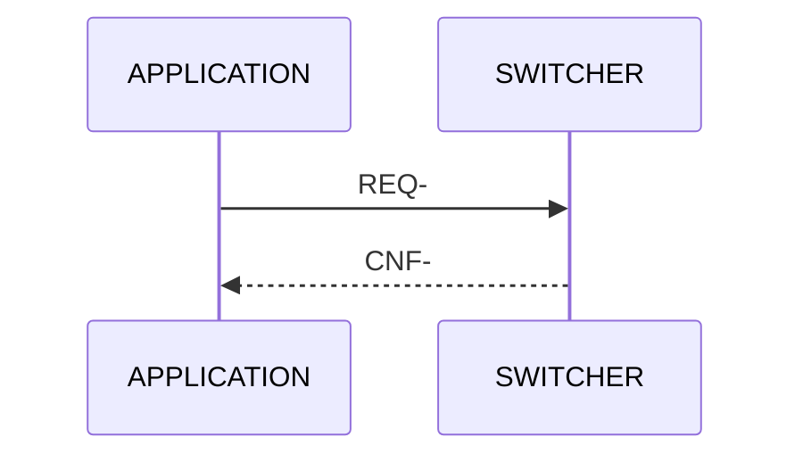
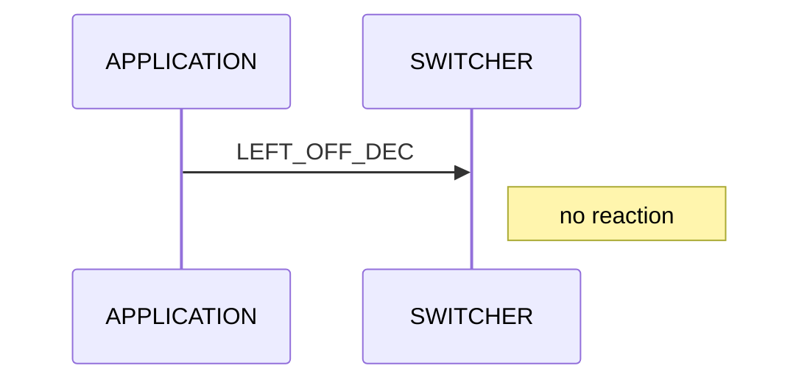
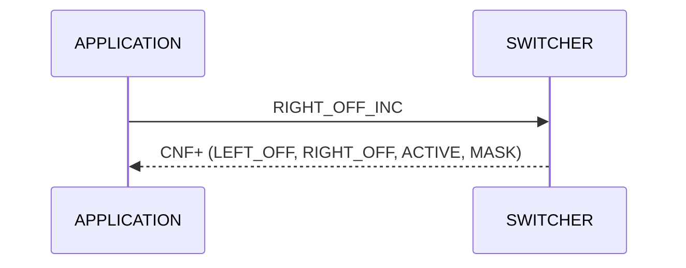
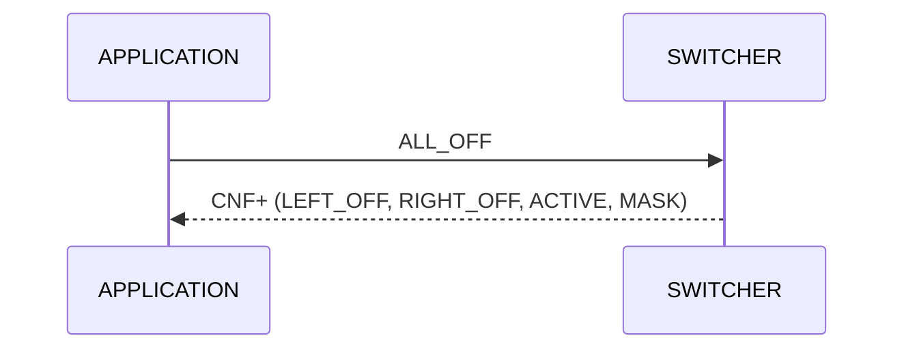
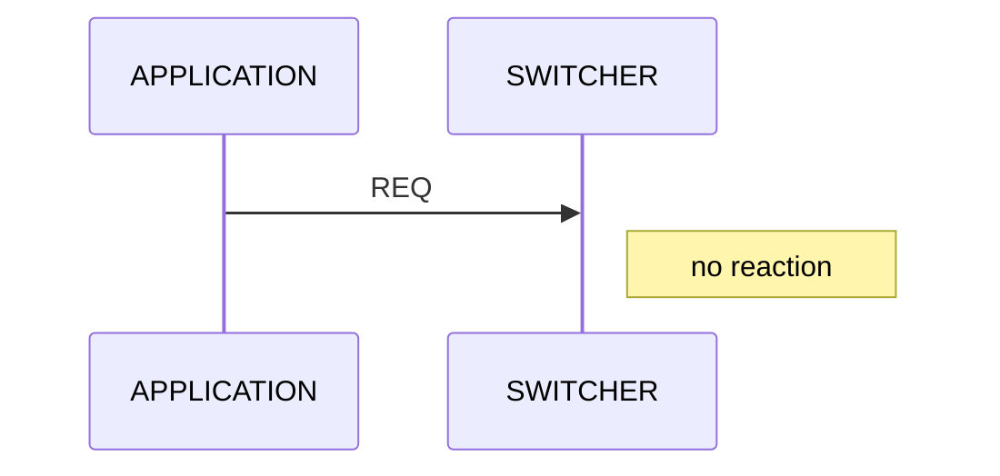

# SEC_SWITCH_LR_QUARTER_WORD

* * * * * * * * * *

## Introduction

The function block **SEC_SWITCH_LR_QUARTER_WORD** is a section switcher: it switches sections (part widths) off and on again from the left and from the right, for example for a four-key section switcher on a machine. It manages up to 8 sections and outputs the mask as `WORD` with two bits per section (condensed work state). Section 1 is the leftmost section and occupies the least significant bits. The block is pure Structured Text and depends only on `core`, so it needs no ISOBUS. The meaning of the 2-bit values is explained on the page [Condensed Work State](https://meisterschulen-am-ostbahnhof-munchen-docs.readthedocs.io/projects/isobus-other-docs/en/latest/Condensed-Work-State/).

## Interface Structure

### **Event Inputs**

| Name | Type | Comment | Associated data |
| ---- | ---- | ------- | --------------- |
| INIT | EInit | Initialization, counters to 0 | QI, N |
| REQ | Event | Output mask and counters again | QI |
| LEFT_OFF_INC | Event | Switch off one more section from the left | - |
| LEFT_OFF_DEC | Event | Switch one section back on from the left | - |
| RIGHT_OFF_INC | Event | Switch off one more section from the right | - |
| RIGHT_OFF_DEC | Event | Switch one section back on from the right | - |
| ALL_ON | Event | Switch on all sections (both counters 0) | - |
| ALL_OFF | Event | Switch off all sections (LEFT_OFF = N, RIGHT_OFF = 0) | - |

### **Event Outputs**

| Name | Type | Comment | Associated data |
| ---- | ---- | ------- | --------------- |
| INITO | EInit | Initialization confirmed | QO, LEFT_OFF, RIGHT_OFF, ACTIVE, MASK |
| CNF | Event | Counters or mask recalculated | QO, LEFT_OFF, RIGHT_OFF, ACTIVE, MASK |

### **Data Inputs**

| Name | Type | Comment |
| ---- | ---- | ------- |
| QI | BOOL | Only at INIT and REQ: INIT+ active, INIT- deactivated (mask all free), REQ- without effect |
| N | UINT | Number of sections (1..8, larger values are limited to 8) |

### **Data Outputs**

| Name | Type | Comment |
| ---- | ---- | ------- |
| LEFT_OFF | UINT | Number of sections switched off from the left |
| RIGHT_OFF | UINT | Number of sections switched off from the right |
| ACTIVE | UINT | Number of free sections |
| QO | BOOL | TRUE = active and event executed |
| MASK | WORD | Condensed work state, 2 bits per section: 01 free, 00 blocked, 11 not present (section > N), bits 1..0 = section 1 (left) |

### **Adapters**

None.

## Functionality

- **Initialization:** `INIT` with `QI` = TRUE takes over `N` (limited to 8), sets both counters to 0 (all sections free) and reports `INITO` with `QO` = TRUE. In the active state `INIT+` initializes again. `INIT` with `QI` = FALSE deactivates the block, the mask is then completely free, `INITO` comes with `QO` = FALSE. This also applies before the first `INIT+`, so INIT chains do not hang.
- **Switching off from left or right:** `LEFT_OFF_INC` or `RIGHT_OFF_INC` switches off one more section from the respective side as long as a section is still free. If all sections are off, there is no reaction.
- **Switching on:** `LEFT_OFF_DEC` or `RIGHT_OFF_DEC` switches a section back on. If the counter of that side is already 0, there is no reaction. This does not apply when all sections are off (see next item).
- **Symmetric switching on after `ALL_OFF` (since version 1.1):** If all sections are off and the own counter is 0, that side first takes over all switched-off sections. `LEFT_OFF_DEC` then switches on the right section `N`, then `N-1` and so on, `RIGHT_OFF_DEC` the left section 1, then 2.
- **`ALL_ON` and `ALL_OFF`:** `ALL_ON` sets both counters to 0 (all free). `ALL_OFF` sets `LEFT_OFF` = `N` and `RIGHT_OFF` = 0 (all blocked).
- **`QI`:** `QI` is wired only to `INIT` and `REQ`. Keys, `ALL_ON` and `ALL_OFF` act in the active state without `QI`. `REQ` with `QI` = FALSE changes nothing and answers with `CNF`, `QO` = FALSE.
- **Before initialization:** `REQ`, keys, `ALL_ON` and `ALL_OFF` before `INIT+` or after `INIT-` stay without reaction.
- **Calculation (`CALC`):** The counters are limited to `N`, `ACTIVE` = `N` − `LEFT_OFF` − `RIGHT_OFF`. The mask is calculated from `ACTIVE` and `LEFT_OFF` without a loop. Free is `01`, blocked is `00`, sections above `N` are `11` (not present).

### Example

`N` = 8, `LEFT_OFF` = 2, `RIGHT_OFF` = 1: `ACTIVE` = 5, sections 3 to 7 are free, sections 1, 2 and 8 are blocked. `MASK` = `16#1550` (bit pairs per section, section 1 at the bottom).

## Usage

1. Trigger `INIT` with `QI` = TRUE and `N` = number of sections.
2. Connect the four keys to `LEFT_OFF_INC/DEC` and `RIGHT_OFF_INC/DEC`, optionally `ALL_ON`/`ALL_OFF`.
3. Process `MASK` (and, if needed, `LEFT_OFF`, `RIGHT_OFF`, `ACTIVE`) at every `CNF`.
4. `REQ` outputs the current state again at any time.

## State Overview

All events are evaluated in state `ST_READY`; after its action every state returns to `ST_READY`. The conditions of the counter events (for example `LEFT_OFF + RIGHT_OFF < MIN(N, 8)`) are guards on the transitions.

| State | Meaning |
| ----- | ------- |
| `START` | Not initialized or deactivated |
| `ST_INIT` | `INIT+`: take over `N`, counters 0, `INITO` |
| `ST_READY` | Active, waits for events |
| `ST_DEINIT` | `INIT-`: deactivated, mask all free, `INITO` |
| `ST_REQ` | `REQ+`: output mask and counters (`CNF`) |
| `ST_REQ_INHIBITED` | `REQ-`: change nothing, `CNF` with `QO` = FALSE |
| `ST_LEFT_INC` | `LEFT_OFF_INC`: increase the left counter |
| `ST_LEFT_DEC` | `LEFT_OFF_DEC`: decrease the left counter |
| `ST_RIGHT_INC` | `RIGHT_OFF_INC`: increase the right counter |
| `ST_RIGHT_DEC` | `RIGHT_OFF_DEC`: decrease the right counter |
| `ST_ALL_ON` | `ALL_ON`: both counters 0 |
| `ST_ALL_OFF` | `ALL_OFF`: `LEFT_OFF` = `N`, `RIGHT_OFF` = 0 |

## Service Sequences

The type has a `<Service>` element (LeftInterface `APPLICATION`, RightInterface `SWITCHER`). `QI` acts only at `INIT` and `REQ` (INIT+/INIT-, REQ+/REQ-). The sequences are shown below as sequence diagrams.

### `normal_initialization`

INIT with QI = TRUE: take over N, all sections free

### `re_initialization`

INIT+ in the active state: initialize again, counters 0

### `termination`

INIT with QI = FALSE: deactivated, mask all free

### `termination_without_initialization`

INIT- before INIT+ is also answered with INITO- (INIT chains do not hang)

### `request`

Output mask and counters again

### `request_inhibited`

REQ with QI = FALSE: change nothing

### `left_off_increment`

Switch off one more section from the left

### `left_off_increment_at_limit`

All sections already off: no reaction

### `left_off_decrement`

Switch one section back on from the left

### `left_off_decrement_at_zero`

LEFT_OFF = 0: no reaction

### `right_off_increment`

Switch off one more section from the right

### `right_off_decrement`

Switch one section back on from the right

### `all_on`

Switch on all sections

### `all_off`

Switch off all sections (LEFT_OFF = N)

### `event_before_initialization`

REQ, keys, ALL_ON/ALL_OFF before INIT+ or after INIT-: no reaction

### `left_on_after_all_off`

After ALL_OFF: LEFT_OFF_DEC switches on the right section N, then N-1 ...

### `right_on_after_all_off`

After ALL_OFF: RIGHT_OFF_DEC switches on the left section 1, then 2 ...

## Technical Details

- Pure Structured Text block without ISOBUS reference, depends only on `core`.
- The outputs `QO`, `LEFT_OFF`, `RIGHT_OFF`, `ACTIVE` and `MASK` belong to `INITO` and `CNF`.
- `LEFT_OFF_DEC` and `RIGHT_OFF_DEC` additionally protect against UINT underflow in the algorithm, besides the ECC condition.
- The mask is calculated without a loop (shifting with a wider intermediate value, special case for full width).
- The single-value and array variants differ only in `N` and `MASK`. See the [overview](index.md).

## Conclusion

`SEC_SWITCH_LR_QUARTER_WORD` switches sections off and on from the left and right and delivers the mask as two bits per section (condensed work state), with section 1 on the left in the least significant bits.
