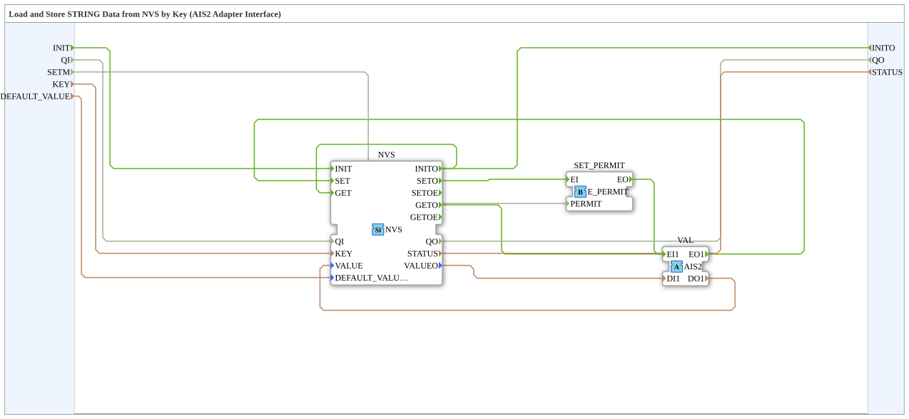

# NVS_AIS2

* * * * * * * * * *

## Introduction

The **NVS_AIS2** function block is used to load and store STRING data in non-volatile storage (NVS) of an ESP32 via an adapter. It encapsulates initialization and access to a single NVS entry identified by a KEY.

## Interface Structure

### **Event Inputs**

| Event | Type | Comment | Associated Variables |
| ----- | ---- | ------- | -------------------- |
| `INIT` | EInit | Service Initialization | QI, SETM, KEY, DEFAULT_VALUE |

### **Event Outputs**

| Event | Type | Comment | Associated Variables |
| ----- | ---- | ------- | -------------------- |
| `INITO` | EInit | Initialization Confirm | QO, STATUS |

### **Data Inputs**

| Name | Type | Comment |
| ---- | ---- | ------- |
| `QI` | BOOL | Event Input Qualifier |
| `SETM` | BOOL | Enable mirroring on SET |
| `KEY` | STRING | Key name for NVS entry |
| `DEFAULT_VALUE` | STRING | Default value if key does not exist in NVS (Default: '') |

### **Data Outputs**

| Name | Type | Comment |
| ---- | ---- | ------- |
| `QO` | BOOL | Event Output Qualifier |
| `STATUS` | STRING | Service status |

### **Adapters**

| Adapter | Type | Comment |
| ------- | ---- | ------- |
| `VAL` | `adapter::types::bidirectional::AIS2` (Socket) | Value (STRING) |

## Functionality

1. **Initialization**: An `INIT` event initializes the internal NVS block.
2. **Read value**: The read value is output via `VAL.DI1`.
3. **Store value**: An external block sends `EO1` via `VAL` to write a new value (`DO1`) to NVS.
