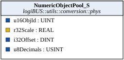

# NumericObjectPool_S

* * * * * * * * * *

## Introduction

Description from the comment of the type: ISOBUS UT Numeric Object (InputNumber/OutputNumber) pool properties

Package: `logiBUS::utils::conversion::phys`

## Interface structure

### **Fields**

-   **u16ObjId** (Type: `UINT`): ISOBUS Object ID (Default: `IDs::ID_NULL`)
-   **r32Scale** (Type: `REAL`): Scale factor from object pool (e.g. 0.01) (Default: `1.0`)
-   **i32Offset** (Type: `DINT`): Offset from object pool (e.g. -100000) (Default: `0`)
-   **u8Decimals** (Type: `USINT`): Number of decimal places (Default: `0`)

Note: This page was generated from the type definition (`NumericObjectPool_S.dtp`) and only shows the interface. A detailed description of the behavior is still missing.
