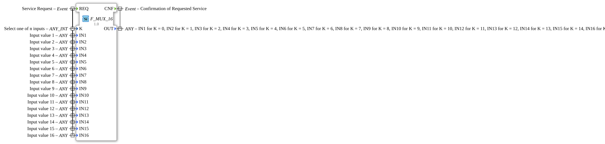

# F_MUX_16

* * * * * * * * * *

## Introduction

The `F_MUX_16` is a multiplexer according to IEC 61131-3 (standard selection function, generic block) that, based on the selector `K`, switches one of **16 inputs** to the output `OUT`. It is the 16-channel variant of [`F_MUX_8`](F_MUX_8.md) and [`F_MUX_4`](F_MUX_4.md).

## Interface Structure

### **Event Inputs**

- **REQ**: Service request. Associated data: `IN1` to `IN16`, `K`

### **Event Outputs**

- **CNF**: Confirmation of the requested service. Associated data: `OUT`

### **Data Inputs**

- **K** (`ANY_INT`): Selects one of the inputs
- **IN1** to **IN16** (`ANY`): Input values 1 to 16

### **Data Outputs**

- **OUT** (`ANY`): Selected input value (see table)

### **Adapters**

This function block uses no adapters.

## How it works

On `REQ`, the input selected by `K` is output at `OUT`, then `CNF` is fired. `K` counts from 0:

| K | OUT | K | OUT |
| --- | --- | --- | --- |
| 0 | `IN1` | 8 | `IN9` |
| 1 | `IN2` | 9 | `IN10` |
| 2 | `IN3` | 10 | `IN11` |
| 3 | `IN4` | 11 | `IN12` |
| 4 | `IN5` | 12 | `IN13` |
| 5 | `IN6` | 13 | `IN14` |
| 6 | `IN7` | 14 | `IN15` |
| 7 | `IN8` | 15 | `IN16` |

## Technical Details

- Generic block (`GEN_F_MUX`, FORTE); the input data types are `ANY` and must match `OUT`.
- Belongs to the package `iec61131::selection`.

## Application Scenarios

- Selecting one of up to 16 values, e.g. constants, setpoints or object IDs, via an index

## Summary

`F_MUX_16` switches one of 16 input values to the output based on the index `K` (0 to 15).
