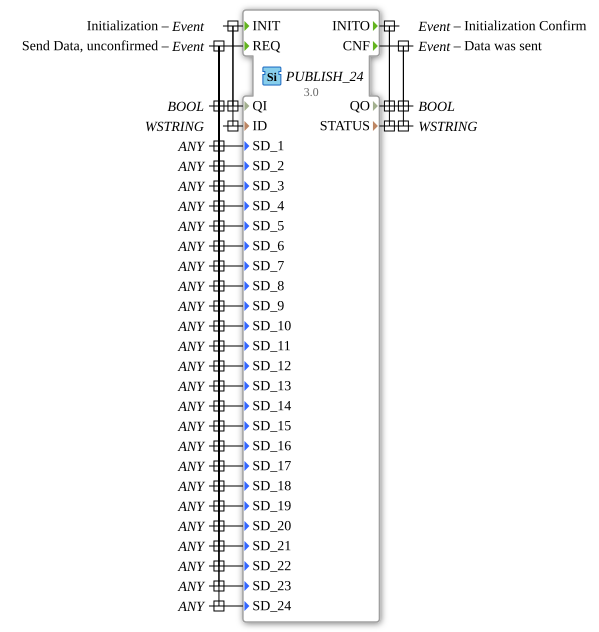

# PUBLISH_24

* * * * * * * * * *

## Introduction

The function block `PUBLISH_24` distributes data to one or more [`SUBSCRIBE_24`](SUBSCRIBE_24.md) blocks. It allows the unconfirmed transmission of up to 24 data values using a publish-subscribe communication pattern.

## Interface Structure

### **Event Inputs**

- **INIT** (`EInit`): initialisation. Associated with `QI`, `ID`.
- **REQ**: send data, unconfirmed. Associated with `QI`, `SD_1` to `SD_24`.

### **Event Outputs**

- **INITO** (`EInit`): initialisation confirm. Associated with `QO`, `STATUS`.
- **CNF**: data was sent. Associated with `QO`, `STATUS`.

### **Data Inputs**

- **QI** (`BOOL`): event input qualifier
- **ID** (`WSTRING`): identification string of the communication channel
- **SD_1** to **SD_24** (`ANY`): data values of any type to send

### **Data Outputs**

- **QO** (`BOOL`): event output qualifier
- **STATUS** (`WSTRING`): status information

### **Adapters**

No adapter interfaces available.

## Functionality

After initialisation with `INIT`, `REQ` distributes up to 24 data values to all registered subscribers. The transmission is unconfirmed; `CNF` only reports that the data was sent.

## Technical Details

- Generic block (generic class `GEN_PUBLISH`): the number of data ports is 24 here, their types (`ANY`) are fixed at instantiation
- Unicode strings (`WSTRING`) for `ID` and `STATUS`
- Counterpart: `SUBSCRIBE_24` with `RD_1` to `RD_24`

## Application Scenarios

- Distributing many related values (e.g. measured values or states) with a single event to other applications or devices

## ⚖️ Comparison with Similar Building Blocks

[`PUBLISH_10`](PUBLISH_10.md) transmits up to 10 data values, `PUBLISH_24` up to 24.

## Conclusion

`PUBLISH_24` is the unconfirmed publish variant for up to 24 data values.
