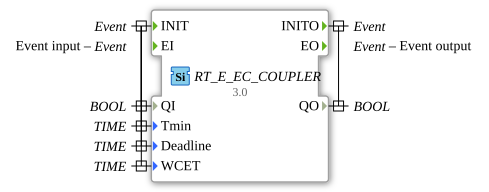

# RT_E_EC_COUPLER

* * * * * * * * * *

## Introduction

Couples event chains with real-time parameters.

## Interface Structure

### **Event Inputs**

- **INIT**: Initialization, carries `QI`, `Tmin`, `Deadline` and `WCET`.
- **EI**: Event input (start of the coupling); carries no data.

### **Event Outputs**

- **INITO**: Confirms the initialization, carries `QO`.
- **EO**: Event output (continuation of the event chain); carries no data.

### **Data Inputs**

- **QI** (`BOOL`): Qualifier for the initialization.
- **Tmin** (`TIME`): Real-time parameter (minimum distance).
- **Deadline** (`TIME`): Real-time parameter (deadline).
- **WCET** (`TIME`): Real-time parameter (worst-case execution time).

### **Data Outputs**

- **QO** (`BOOL`): Output qualifier of the initialization.

## Metadata

| Attribute     | Value                            |
| :------------ | :------------------------------- |
| License       | EPL-2.0                          |
| Version       | 3.0 (2025-04-14, Patrick Aigner) |
| 4diac Package | eclipse4diac::rtevents           |

---

### 🌐 Related topic subpages on ms-muc-docs.de

- [🌐 Eclipse 4diac IDE & Color Reference on ms-muc-docs.de](https://www.ms-muc-docs.de/iec-61499/eclipse-4diac/)

]
